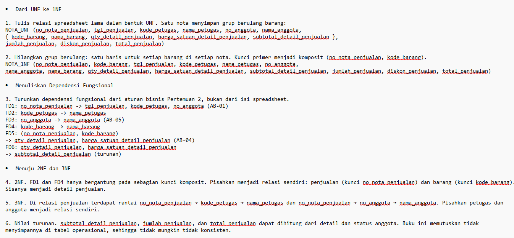
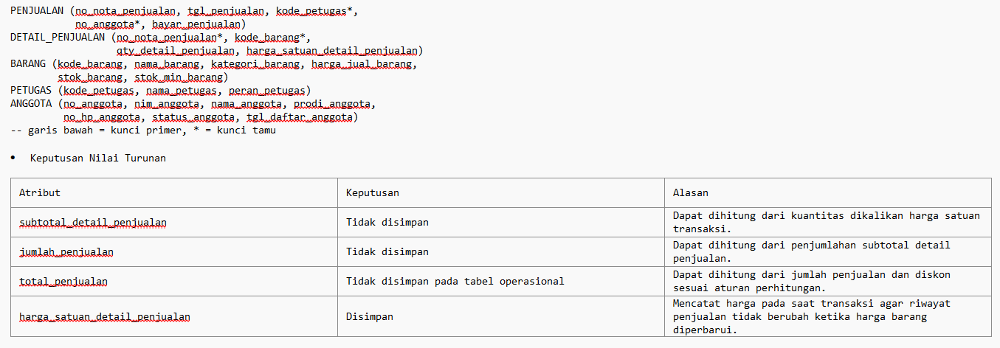
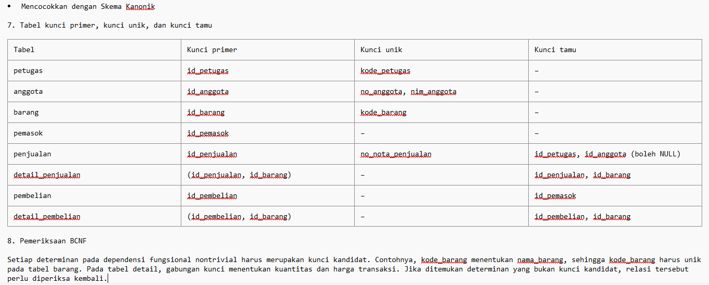

# Laporan Praktikum Basis Data
## Pertemuan 04 — Normalisasi Basis Data

> **Nama:** Nazia Karinnafila  
> **NIM:** 25430035  
> **Kelas:** B  
> **Tanggal:** 21 Oktober 2026
---

## 1. Tujuan Praktikum

Setelah praktikum, mahasiswa diharapkan mampu:

- Mengidentifikasi anomali ubah, sisip, dan hapus pada data yang belum dinormalisasi.
- Menuliskan dependensi fungsional berdasarkan aturan bisnis.
- Menormalisasi relasi hingga Bentuk Normal Ketiga (3NF) dan memeriksa BCNF.
- Menentukan apakah nilai turunan perlu disimpan atau dihitung.
- Mendokumentasikan skema relasional akhir.

## 2. Ringkasan Dasar Teori

### 2.1 Normalisasi

Normalisasi adalah proses menyusun tabel dan relasi basis data agar redundansi data berkurang serta anomali saat penyisipan, perubahan, dan penghapusan data dapat dihindari. Normalisasi dilakukan dengan memisahkan atribut ke relasi yang sesuai berdasarkan dependensi fungsionalnya, tanpa menghilangkan makna hubungan data.

### 2.2 Dependensi Fungsional

Dependensi fungsional (*functional dependency*) menyatakan bahwa suatu atribut atau kumpulan atribut menentukan nilai atribut lain. Jika `X → Y`, maka setiap nilai `X` menentukan tepat satu nilai `Y` dalam relasi. Dependensi fungsional membantu mengidentifikasi kunci, mengurangi pengulangan data, serta menjaga integritas dan konsistensi basis data.

### 2.3 Bentuk Normal

- **Bentuk Normal Pertama (1NF):** setiap atribut berisi nilai atomik dan tidak terdapat grup data berulang dalam satu sel.
- **Bentuk Normal Kedua (2NF):** relasi telah memenuhi 1NF dan setiap atribut non-primer bergantung penuh pada seluruh kunci kandidat, bukan hanya sebagian dari kunci komposit.
- **Bentuk Normal Ketiga (3NF):** relasi telah memenuhi 2NF dan tidak memiliki dependensi transitif atribut non-primer terhadap kunci.
- **Boyce-Codd Normal Form (BCNF):** untuk setiap dependensi fungsional nontrivial `X → Y`, `X` harus merupakan superkey.

## 3. Hasil Langkah Percobaan






## 4. Jawaban Titik Analisis

### 4.1 Titik Analisis 1 — Harga pada Detail Penjualan

FD5 menempatkan `harga_satuan_detail_penjualan` pada kunci `(no_nota_penjualan, kode_barang)` karena harga tersebut merupakan harga barang yang digunakan pada waktu transaksi. Harga barang dapat berubah dari waktu ke waktu, sehingga harga pada nota lama tidak selalu sama dengan harga barang saat ini.

Jika harga transaksi lama hanya diambil dari tabel barang, perubahan harga saat ini dapat menyebabkan laporan omzet historis menggunakan harga terbaru, bukan harga pada saat transaksi terjadi. Karena itu, harga satuan transaksi disimpan pada detail penjualan.

### 4.2 Titik Analisis 2 — Penyimpanan Nilai Total

Keputusan untuk tidak menyimpan `subtotal_detail_penjualan`, `jumlah_penjualan`, dan `total_penjualan` pada tabel operasional konsisten dengan keputusan menyimpan total pada tabel arsip penjualan.

Pada tabel operasional, nilai tersebut dapat dihitung dari rincian transaksi. Sementara itu, tabel arsip dapat menyimpan total historis saat transaksi terjadi sehingga perubahan data operasional di kemudian hari tidak mengubah catatan transaksi historis. Keputusan ini bergantung pada tujuan penyimpanan: operasional atau arsip historis.

### 4.3 Titik Analisis 3 — Informasi Pemasok

Informasi pemasok disimpan melalui tabel pemasok, pembelian, dan detail pembelian. Dengan desain ini, satu barang dapat diperoleh dari pemasok yang berbeda. Jika nama pemasok disimpan langsung di tabel barang, tabel tersebut hanya menunjukkan satu pemasok dan tidak mewakili riwayat pembelian dari pemasok lain. Pemisahan ini juga mengurangi pengulangan informasi pemasok.

## 5. Hasil Latihan dan Modifikasi

### 5.1 Pemasok dengan Beberapa Nomor Telepon

Jika satu pemasok memiliki beberapa nomor telepon, nomor telepon tidak disimpan sebagai daftar dalam satu kolom `PEMASOK`. Untuk memenuhi 1NF, nomor telepon dipisahkan ke relasi `TELEPON_PEMASOK`.

**Relasi hasil normalisasi:**

```text
PEMASOK(
    id_pemasok,
    nama_pemasok,
    alamat_pemasok
)

TELEPON_PEMASOK(
    id_pemasok,
    no_telepon
)
```

Keterangan:
- `id_pemasok` merupakan kunci primer pada tabel `PEMASOK`.
- `(id_pemasok, no_telepon)` merupakan kunci primer gabungan pada tabel `TELEPON_PEMASOK`.
- `id_pemasok` pada `TELEPON_PEMASOK` merupakan kunci tamu yang mengacu ke `PEMASOK`.

### 5.2 Anomali Ubah jika `nama_anggota` Disimpan di Tabel Penjualan

Contoh data:

| no_nota_penjualan | no_anggota | nama_anggota |
|---|---|---|
| PJ-0142 | A001 | Budi S. |
| PJ-0143 | A001 | Budi S. |
| PJ-0150 | A001 | Budi Santoso |

Dependensi fungsional:

```text
no_nota_penjualan → no_anggota
no_anggota        → nama_anggota
```

Terdapat dependensi transitif dari `no_nota_penjualan` ke `nama_anggota` melalui `no_anggota`. Karena nama anggota seharusnya ditentukan oleh `no_anggota`, penyimpanan nama anggota pada tabel penjualan dapat menimbulkan ketidakkonsistenan.

Contoh kueri ubah:

```sql
UPDATE penjualan
SET nama_anggota = 'Budi Santoso'
WHERE no_nota_penjualan = 'PJ-0142';
```

Jika hanya satu baris yang diubah, nota `PJ-0142` akan mencatat `Budi Santoso`, sedangkan nota lain milik anggota yang sama mungkin masih mencatat `Budi S.`. Akibatnya, data anggota menjadi tidak konsisten.

## 6. Tugas Mandiri — Milestone Proyek 04

Dokumen ini menggunakan kebutuhan sistem dan aturan bisnis proyek **Klinik Sehat ZI**.

### 6.1 Dari UNF ke 1NF

**1. Bentuk UNF**

Satu resep menyimpan grup berulang obat:

```text
RESEP_UNF(
    id_resep,
    tanggal_resep,
    id_pemeriksaan,
    dokter,
    {
        id_obat,
        nama_obat,
        jumlah_obat,
        aturan_pemakaian
    }
)
```

**2. Bentuk 1NF**

Grup berulang dihilangkan dengan membuat satu baris untuk setiap obat dalam setiap resep. Kunci primer menjadi komposit `(id_resep, id_obat)`.

```text
RESEP_1NF(
    id_resep,
    id_obat,
    tanggal_resep,
    id_pemeriksaan,
    dokter,
    nama_obat,
    jumlah_obat,
    aturan_pemakaian
)
```

### 6.2 Dependensi Fungsional

Dependensi fungsional diturunkan dari aturan bisnis proyek, bukan hanya dari isi contoh data.

```text
FD1:  id_pasien → NIK, nama_pasien, tanggal_lahir,
                   jenis_kelamin, alamat, no_HP
      (AB-01 dan aturan NIK wajib unik)

FD2:  id_kunjungan → id_pasien, tanggal_kunjungan,
                     jenis_kunjungan, keluhan
      (AB-02)

FD3:  id_pemeriksaan → id_kunjungan,
                       hasil_pemeriksaan, diagnosis
      (AB-03)

FD4:  id_resep → id_pemeriksaan, tanggal_resep, dokter
      (AB-04, mengikuti ERD)

FD5:  (id_resep, id_obat) → jumlah_obat, aturan_pemakaian
      (AB-05)

FD6:  id_pembayaran → id_kunjungan, tanggal_pembayaran,
                       total_bayar, metode_pembayaran
      (AB-07)

FD7:  id_obat → nama_obat, satuan, harga_obat, stok_obat

FD8:  id_pemasok → nama_pemasok, alamat, no_HP

FD9:  id_penerimaan → id_pemasok, tanggal_penerimaan

FD10: (id_penerimaan, id_obat) → jumlah_diterima

FD11: NIK → id_pasien, nama_pasien, tanggal_lahir,
             jenis_kelamin, alamat, no_HP
      (aturan bisnis: NIK wajib dan unik)
```

### 6.3 Menuju 2NF dan 3NF

**4. Bentuk Normal Kedua (2NF)**

Pada relasi `RESEP_1NF`, kunci komposit terdiri dari `id_resep` dan `id_obat`. Atribut `tanggal_resep`, `id_pemeriksaan`, dan `dokter` hanya bergantung pada `id_resep`, sedangkan `nama_obat` bergantung pada `id_obat`. Atribut tersebut dipisahkan ke relasi resep dan obat. Atribut `jumlah_obat` dan `aturan_pemakaian` tetap berada pada relasi detail resep karena bergantung pada keseluruhan kunci komposit.

**5. Bentuk Normal Ketiga (3NF)**

Atribut pemeriksaan seperti `hasil_pemeriksaan` dan `diagnosis` bergantung pada `id_pemeriksaan`, bukan langsung pada `id_resep`. Karena itu, data pemeriksaan dipisahkan ke relasi `PEMERIKSAAN`. Data pasien disimpan dalam relasi `PASIEN`, sedangkan data kunjungan disimpan dalam relasi `KUNJUNGAN`. Pemisahan ini menghindari pengulangan data pasien, kunjungan, pemeriksaan, dan obat pada tabel resep.

**6. Keputusan nilai turunan**

Atribut `total_bayar` dapat dihitung dari biaya transaksi, tetapi dapat tetap disimpan sebagai catatan nominal pembayaran saat transaksi terjadi. Atribut `stok_obat` disimpan sebagai stok terkini dan harus diperbarui secara konsisten ketika obat diterima atau dikeluarkan. Atribut `jumlah_obat` dan `jumlah_diterima` tetap disimpan karena merupakan fakta kuantitas pada transaksi resep dan penerimaan.

### 6.4 Skema Relasional Akhir

```text
PASIEN(
    id_pasien, NIK*, nama_pasien, tanggal_lahir,
    jenis_kelamin, alamat, no_HP
)

KUNJUNGAN(
    id_kunjungan, id_pasien*, tanggal_kunjungan,
    jenis_kunjungan, keluhan
)

PEMERIKSAAN(
    id_pemeriksaan, id_kunjungan*,
    hasil_pemeriksaan, diagnosis
)

RESEP(
    id_resep, id_pemeriksaan*, tanggal_resep, dokter
)

DETAIL_RESEP(
    id_resep*, id_obat*, jumlah_obat, aturan_pemakaian
)

OBAT(
    id_obat, nama_obat, satuan, harga_obat, stok_obat
)

PEMBAYARAN(
    id_pembayaran, id_kunjungan*,
    tanggal_pembayaran, total_bayar, metode_pembayaran
)

PEMASOK(
    id_pemasok, nama_pemasok, alamat, no_HP
)

PENERIMAAN(
    id_penerimaan, id_pemasok*, tanggal_penerimaan
)

DETAIL_PENERIMAAN(
    id_penerimaan*, id_obat*, jumlah_diterima
)
```

Keterangan: tanda `*` menunjukkan kunci tamu (FK). Penentuan kunci primer (PK) mengikuti ERD proyek. PK gabungan `DETAIL_RESEP` adalah `(id_resep, id_obat)`, sedangkan PK gabungan `DETAIL_PENERIMAAN` adalah `(id_penerimaan, id_obat)`. NIK direncanakan sebagai `NOT NULL` dan `UNIQUE`.

### 6.5 Mencocokkan dengan Skema Kanonik

**7. Membandingkan skema kanonik**

Hasil normalisasi dibandingkan dengan ERD Klinik Sehat ZI. Perbedaan utama terdapat pada penggunaan kunci pengganti (*surrogate key*) `id_*` sebagai kunci primer, sedangkan atribut alami seperti NIK digunakan sebagai atribut unik. Pada tabel detail resep dan detail penerimaan, kunci primer merupakan gabungan dua kunci tamu.

**8. Memeriksa PK, UNIQUE, dan FK**

Setiap tabel harus memiliki kunci primer, hubungan antartabel menggunakan kunci tamu yang sesuai dengan ERD, dan atribut yang harus unik memiliki batasan `UNIQUE`. Pada tabel `PASIEN`, NIK ditetapkan `NOT NULL` dan `UNIQUE` berdasarkan asumsi bahwa setiap pasien wajib memiliki NIK yang berbeda.

**9. Memeriksa BCNF**

Suatu relasi memenuhi BCNF apabila setiap determinan pada dependensi fungsional nontrivial merupakan superkey. Pemeriksaan dilakukan dengan memastikan atribut penentu seperti `id_pasien`, `id_kunjungan`, `id_pemeriksaan`, `id_resep`, `id_obat`, `id_pembayaran`, `id_pemasok`, dan `id_penerimaan` merupakan kunci pada relasi masing-masing. Pada tabel detail, gabungan kunci primer menentukan atribut transaksi yang bergantung pada seluruh kunci.

| Tabel | Kunci primer (PK) | Kunci unik | Kunci tamu (FK) |
|---|---|---|---|
| `PASIEN` | `id_pasien` | `NIK` | — |
| `KUNJUNGAN` | `id_kunjungan` | — | `id_pasien` |
| `PEMERIKSAAN` | `id_pemeriksaan` | — | `id_kunjungan` |
| `RESEP` | `id_resep` | — | `id_pemeriksaan` |
| `DETAIL_RESEP` | `(id_resep, id_obat)` | — | `id_resep`, `id_obat` |
| `OBAT` | `id_obat` | — | — |
| `PEMBAYARAN` | `id_pembayaran` | — | `id_kunjungan` |
| `PEMASOK` | `id_pemasok` | — | — |
| `PENERIMAAN` | `id_penerimaan` | — | `id_pemasok` |
| `DETAIL_PENERIMAAN` | `(id_penerimaan, id_obat)` | — | `id_penerimaan`, `id_obat` |

### 6.6 Keputusan Penyimpanan Nilai Turunan

| Atribut | Keputusan | Alasan |
|---|---|---|
| `total_bayar` | Disimpan | Menjadi catatan nominal pembayaran saat transaksi dilakukan. Nilainya harus konsisten dengan perhitungan biaya transaksi. |
| `stok_obat` | Disimpan | Dibutuhkan untuk mengetahui stok terkini dengan cepat. Nilainya harus diperbarui secara konsisten setiap ada penerimaan atau pengeluaran obat. |
| `jumlah_obat` | Disimpan | Merupakan jumlah obat yang diresepkan pada suatu transaksi, bukan nilai yang dihitung dari atribut lain. |
| `jumlah_diterima` | Disimpan | Mencatat jumlah obat yang diterima dari pemasok pada transaksi penerimaan. |
| `subtotal_detail_resep` | Tidak disimpan | Jika subtotal dihitung dari `jumlah_obat × harga_obat`, nilainya dapat dihitung saat diperlukan. |
| Total hasil penjumlahan rincian biaya | Dihitung jika diperlukan; nominal pembayaran aktual dapat disimpan | Nilai hasil penjumlahan dapat dihitung dari rincian transaksi, sedangkan nominal pembayaran aktual tetap dapat disimpan sebagai catatan transaksi. |

### 6.7 Catatan Perubahan ERD

1. Atribut NIK pada tabel pasien ditetapkan sebagai `UNIQUE` dan `NOT NULL` berdasarkan asumsi bahwa setiap pasien wajib memiliki NIK yang berbeda.
2. Tabel `DETAIL_RESEP` menggunakan kunci primer gabungan `(id_resep, id_obat)`.
3. Tabel `DETAIL_PENERIMAAN` menggunakan kunci primer gabungan `(id_penerimaan, id_obat)`.
4. Hubungan antartabel tetap mengikuti ERD proyek Klinik Sehat ZI.

## ERD KLINIK SEHAT ZI


## 7. Pembahasan dan Kendala

Normalisasi basis data pada proyek Klinik Sehat ZI dilakukan berdasarkan ERD yang telah dibuat sebelumnya. Proses dimulai dengan mengidentifikasi data berulang dan menyusun relasi hingga 3NF, kemudian memeriksa dependensi fungsional. Pada tahap 2NF dan 3NF, data dipisahkan berdasarkan ketergantungannya agar setiap atribut berada pada tabel yang sesuai.

Dalam keputusan nilai turunan, `stok_obat`, `jumlah_obat`, `jumlah_diterima`, dan `total_bayar` disimpan untuk mendukung kebutuhan pencatatan klinik. Sementara itu, subtotal detail resep dapat dihitung saat diperlukan. Selanjutnya, kunci primer, kunci unik, dan kunci tamu diperiksa agar sesuai dengan ERD Klinik Sehat ZI.

Kendala yang ditemui adalah menentukan dependensi fungsional berdasarkan aturan bisnis, bukan hanya contoh data; menentukan atribut yang perlu disimpan dan atribut yang termasuk nilai turunan; serta memeriksa PK, UNIQUE, dan FK pada skema kanonik secara teliti.

## 8. Kesimpulan

Praktikum ini membahas normalisasi basis data untuk mengurangi pengulangan data dan mencegah anomali saat data ditambah, diubah, atau dihapus. Selain itu, praktikum melatih penulisan dependensi fungsional berdasarkan aturan bisnis, normalisasi relasi hingga 3NF, pemeriksaan BCNF, serta pengambilan keputusan mengenai penyimpanan nilai turunan. Normalisasi membantu menghasilkan basis data yang lebih konsisten dan mudah dikelola.

## 9. Pernyataan Penggunaan AI

AI digunakan untuk membantu menjawab pertanyaan pada bagian titik analisis.

## 10. Bukti Git

Repository: [basisdata_25430035](https://github.com/naziakarinnafila-byte/basisdata_25430035)

Commit yang dicatat pada laporan: `e864440..5509f53`

## 11. Checklist Pengumpulan

- [x] Berkas wajib: `p04_normalisasi_<NIM>.md` (proyek)
- [x] Bukti tangkapan layar: tabel tahapan UNF → 1NF → 2NF → 3NF
- [x] Analisis wajib: daftar dependensi fungsional
- [x] Keputusan menyimpan atau menghitung nilai turunan beserta alasannya
