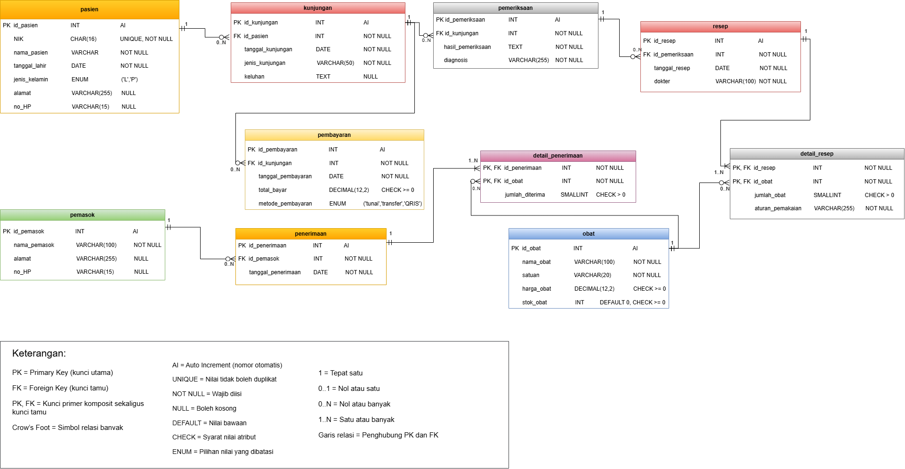

# Modul 4 — Normalisasi dan Skema Relasional
## Proyek: Klinik Sehat ZI

> **Tujuan:** Menata struktur basis data agar mengurangi pengulangan data, menjaga konsistensi, dan memperjelas hubungan antartabel.

---

## 1. Dari UNF ke 1NF

### 1.1 Bentuk UNF

Satu resep dapat berisi beberapa jenis obat. Karena itu, data obat merupakan grup berulang pada bentuk awal (UNF).

```text
RESEP_UNF (
    id_resep,
    tanggal_resep,
    id_pemeriksaan,
    dokter,
    {
        id_obat,
        nama_obat,
        jumlah_obat,
        aturan_pemakaian
    }
)
```

### 1.2 Bentuk 1NF

Untuk menghilangkan grup berulang, setiap baris mewakili satu obat dalam satu resep. Kunci primer pada relasi detail menggunakan gabungan `(id_resep, id_obat)`.

```text
RESEP_1NF (
    id_resep,
    id_obat,
    tanggal_resep,
    id_pemeriksaan,
    dokter,
    nama_obat,
    jumlah_obat,
    aturan_pemakaian
)
```

---

## 2. Dependensi Fungsional

Dependensi fungsional (FD) diturunkan dari aturan bisnis proyek dan struktur ERD, bukan hanya dari contoh data.

| Kode | Dependensi fungsional | Dasar |
|---|---|---|
| FD1 | `id_pasien → NIK, nama_pasien, tanggal_lahir, jenis_kelamin, alamat, no_HP` | AB-01 dan asumsi NIK wajib serta unik |
| FD2 | `id_kunjungan → id_pasien, tanggal_kunjungan, jenis_kunjungan, keluhan` | AB-02 |
| FD3 | `id_pemeriksaan → id_kunjungan, hasil_pemeriksaan, diagnosis` | AB-03 |
| FD4 | `id_resep → id_pemeriksaan, tanggal_resep, dokter` | AB-04 dan ERD |
| FD5 | `(id_resep, id_obat) → jumlah_obat, aturan_pemakaian` | AB-05 |
| FD6 | `id_pembayaran → id_kunjungan, tanggal_pembayaran, total_bayar, metode_pembayaran` | AB-07 |
| FD7 | `id_obat → nama_obat, satuan, harga_obat, stok_obat` | Struktur ERD |
| FD8 | `id_pemasok → nama_pemasok, alamat, no_HP` | Struktur ERD |
| FD9 | `id_penerimaan → id_pemasok, tanggal_penerimaan` | Struktur ERD |
| FD10 | `(id_penerimaan, id_obat) → jumlah_diterima` | Struktur ERD |
| FD11 | `NIK → id_pasien, nama_pasien, tanggal_lahir, jenis_kelamin, alamat, no_HP` | Asumsi NIK wajib dan unik |

**Catatan:** AB-06 mengatur agar stok tidak negatif dan AB-08 mengatur akses data kesehatan. Keduanya merupakan aturan integritas/akses, bukan dependensi fungsional langsung.

---

## 3. Menuju 2NF dan 3NF

### 3.1 Bentuk Normal Kedua (2NF)

Pada `RESEP_1NF`, kunci komposit terdiri dari `id_resep` dan `id_obat`.

- `tanggal_resep`, `id_pemeriksaan`, dan `dokter` bergantung pada `id_resep`.
- `nama_obat` bergantung pada `id_obat`.
- `jumlah_obat` dan `aturan_pemakaian` bergantung pada gabungan `(id_resep, id_obat)`.

Untuk menghilangkan ketergantungan parsial, data resep dan data obat dipisahkan dari detail resep.

### 3.2 Bentuk Normal Ketiga (3NF)

Data pemeriksaan bergantung pada `id_pemeriksaan`, data pasien bergantung pada `id_pasien`, dan data kunjungan bergantung pada `id_kunjungan`. Karena itu, masing-masing disimpan pada relasi tersendiri. Pemisahan ini mengurangi pengulangan data pasien, kunjungan, pemeriksaan, dan obat.

### 3.3 Skema relasional hasil normalisasi

```text
PASIEN (
    id_pasien [PK],
    NIK [UNIQUE, NOT NULL],
    nama_pasien,
    tanggal_lahir,
    jenis_kelamin,
    alamat,
    no_HP
)

KUNJUNGAN (
    id_kunjungan [PK],
    id_pasien [FK],
    tanggal_kunjungan,
    jenis_kunjungan,
    keluhan
)

PEMERIKSAAN (
    id_pemeriksaan [PK],
    id_kunjungan [FK],
    hasil_pemeriksaan,
    diagnosis
)

RESEP (
    id_resep [PK],
    id_pemeriksaan [FK],
    tanggal_resep,
    dokter
)

DETAIL_RESEP (
    id_resep [PK, FK],
    id_obat [PK, FK],
    jumlah_obat,
    aturan_pemakaian
)

OBAT (
    id_obat [PK],
    nama_obat,
    satuan,
    harga_obat,
    stok_obat
)

PEMBAYARAN (
    id_pembayaran [PK],
    id_kunjungan [FK],
    tanggal_pembayaran,
    total_bayar,
    metode_pembayaran
)

PEMASOK (
    id_pemasok [PK],
    nama_pemasok,
    alamat,
    no_HP
)

PENERIMAAN (
    id_penerimaan [PK],
    id_pemasok [FK],
    tanggal_penerimaan
)

DETAIL_PENERIMAAN (
    id_penerimaan [PK, FK],
    id_obat [PK, FK],
    jumlah_diterima
)
```

**Keterangan:** PK = kunci primer, FK = kunci tamu, UNIQUE = nilai tidak boleh sama. Pada `DETAIL_RESEP`, PK gabungan adalah `(id_resep, id_obat)`. Pada `DETAIL_PENERIMAAN`, PK gabungan adalah `(id_penerimaan, id_obat)`. Penetapan `NIK` sebagai `NOT NULL` dan `UNIQUE` merupakan asumsi aturan bisnis yang perlu disesuaikan jika ketentuan proyek berbeda.

---

## 4. Keputusan Penyimpanan Nilai Turunan

| Atribut | Keputusan | Alasan |
|---|---|---|
| `total_bayar` | Disimpan sebagai catatan pembayaran aktual | Menyimpan nominal yang dibayarkan saat transaksi. Nilainya harus konsisten dengan rincian biaya. |
| `stok_obat` | Disimpan | Memudahkan pemeriksaan stok terkini; harus diperbarui secara konsisten saat obat diterima atau dikeluarkan. |
| `jumlah_obat` | Disimpan | Merupakan fakta transaksi yang menunjukkan jumlah obat pada resep. |
| `jumlah_diterima` | Disimpan | Mencatat jumlah obat yang diterima dari pemasok. |
| `subtotal_detail_resep` | Tidak disimpan | Jika dihitung dari jumlah obat dan harga yang berlaku, nilainya dapat dihitung saat diperlukan. |

**Catatan:** Jika `total_bayar` hanya digunakan sebagai hasil penjumlahan rincian biaya, nilai tersebut dapat dihitung. Namun, nominal pembayaran aktual tetap dapat dicatat sebagai fakta transaksi.

---

## 5. Mencocokkan dengan Skema Kanonik

Skema hasil normalisasi dibandingkan dengan ERD Klinik Sehat ZI. Skema menggunakan `id_*` sebagai kunci primer pengganti (*surrogate key*), sedangkan `NIK` digunakan sebagai atribut unik. Tabel detail resep dan detail penerimaan menggunakan kunci primer gabungan yang juga menjadi kunci tamu ke tabel terkait.

### 5.1 Pemeriksaan PK, UNIQUE, dan FK

| Tabel | Kunci primer (PK) | Kunci unik | Kunci tamu (FK) |
|---|---|---|---|
| `pasien` | `id_pasien` | `NIK` | — |
| `kunjungan` | `id_kunjungan` | — | `id_pasien` |
| `pemeriksaan` | `id_pemeriksaan` | — | `id_kunjungan` |
| `resep` | `id_resep` | — | `id_pemeriksaan` |
| `detail_resep` | `(id_resep, id_obat)` | — | `id_resep`, `id_obat` |
| `obat` | `id_obat` | — | — |
| `pembayaran` | `id_pembayaran` | — | `id_kunjungan` |
| `pemasok` | `id_pemasok` | — | — |
| `penerimaan` | `id_penerimaan` | — | `id_pemasok` |
| `detail_penerimaan` | `(id_penerimaan, id_obat)` | — | `id_penerimaan`, `id_obat` |

### 5.2 Pemeriksaan BCNF

Suatu relasi memenuhi Boyce-Codd Normal Form (BCNF) apabila setiap determinan pada dependensi fungsional nontrivial merupakan superkey. Pemeriksaan dilakukan dengan memastikan bahwa penentu seperti `id_pasien`, `id_kunjungan`, `id_pemeriksaan`, `id_resep`, `id_obat`, `id_pembayaran`, `id_pemasok`, dan `id_penerimaan` merupakan kunci pada relasi masing-masing. Pada tabel detail, gabungan kunci digunakan untuk menentukan atribut transaksi yang bergantung pada seluruh kunci.

---

## 6. ERD Klinik Sehat ZI

Gambar ERD diletakkan pada jalur berikut agar dapat ditampilkan di GitHub:



---

## 7. Catatan Perubahan ERD

1. `NIK` pada tabel `pasien` direncanakan sebagai `NOT NULL` dan `UNIQUE`, berdasarkan asumsi setiap pasien wajib memiliki NIK yang berbeda.
2. `detail_resep` menggunakan PK gabungan `(id_resep, id_obat)`.
3. `detail_penerimaan` menggunakan PK gabungan `(id_penerimaan, id_obat)`.
4. Hubungan antartabel lainnya mengikuti ERD proyek Klinik Sehat ZI.

---

## 8. Kesimpulan

Normalisasi dilakukan dari UNF ke 1NF, 2NF, dan 3NF untuk mengurangi pengulangan data serta menjaga konsistensi hubungan antartabel. Hasilnya adalah tabel-tabel terpisah untuk pasien, kunjungan, pemeriksaan, resep, obat, pembayaran, pemasok, dan penerimaan obat. Pemeriksaan kunci serta BCNF membantu memastikan bahwa struktur relasi sesuai dengan dependensi fungsional yang telah diidentifikasi.
