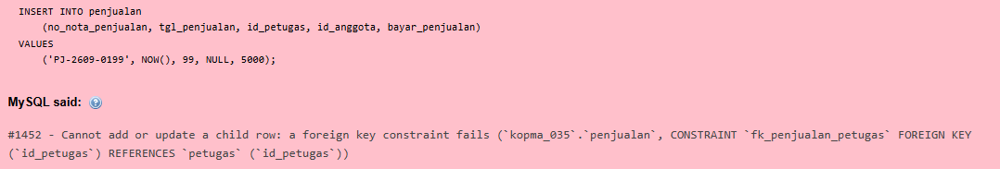
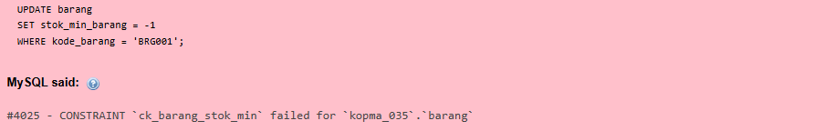
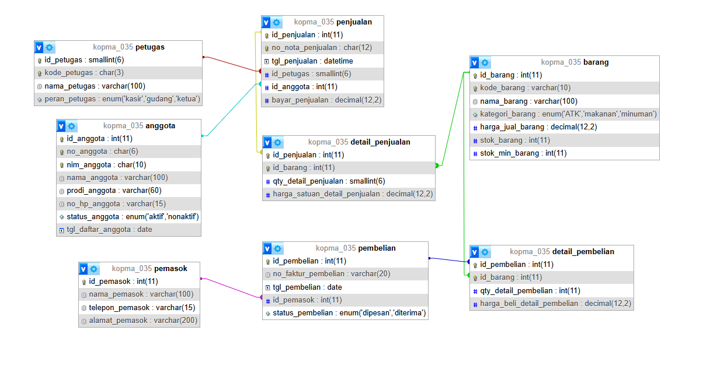
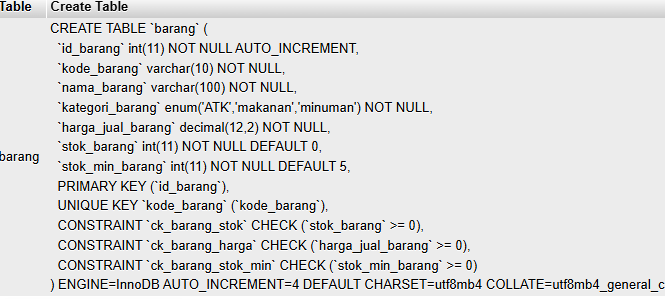
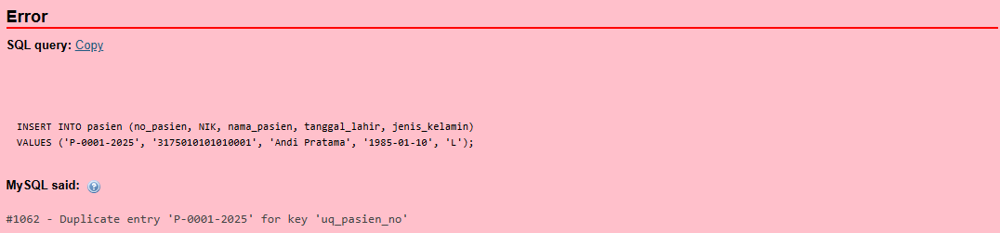
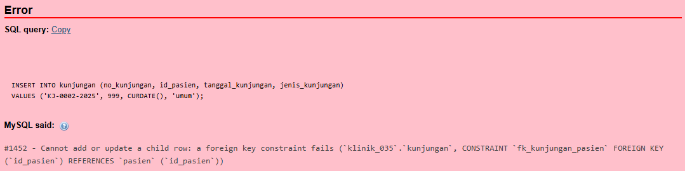
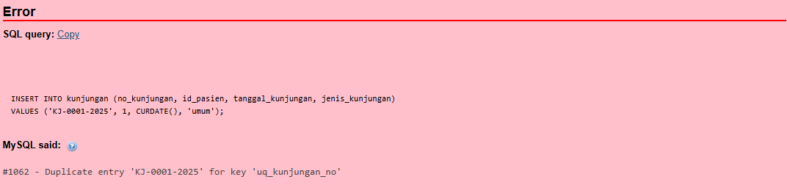
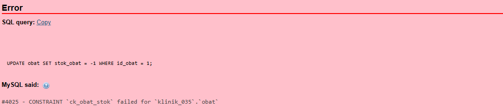
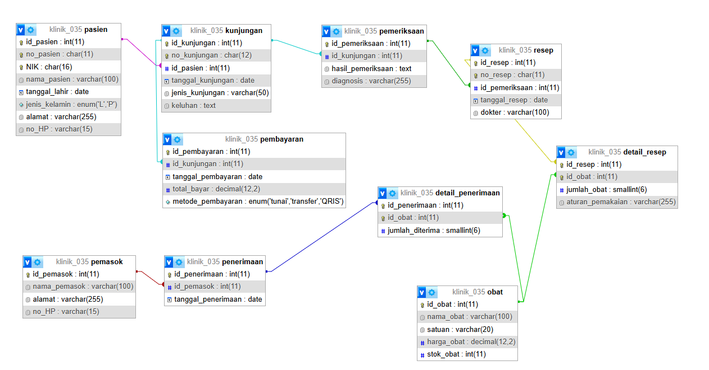

# Laporan Praktikum Basis Data - Pertemuan 05

| | |
|---|---|
| **Nama** | Nazia Karinnafila |
| **NIM** | 25430035 |
| **Kelas** | B |
| **Tanggal** | 28-10-2026 |

---

## 1. Tujuan Praktikum

- Mengubah skema relasional 3NF menjadi perintah CREATE TABLE
- Menambahkan aturan PRIMARY KEY, UNIQUE, NOT NULL, DEFAULT, dan CHECK yang sesuai aturan bisnis
- Mengubah serta menghapus table dengan menggunakan ALTER TABLE dan DROP TABLE
- Menguji aturan tabel menolak data yang salah, dan membandingkan hasil tabel dengan gambar ERD.

## 2. Ringkasan Dasar Teori

### Data Definition Language (DDL)

Data Definition Language subset khusus dari SQL (Structured Query Language) yang terdiri dari kumpulan perintah untuk mendefinisikan, mengubah, dan menghapus struktur database. Berbeda dengan DML (Data Manipulation Language) yang berfokus pada memanipulasi data, DDL justru berkonsentrasi pada pembentukan "kerangka" atau "blueprint" dari database itu sendiri.

### Tipe Data

Tipe data adalah sebuah komponen dari potongan data yang memberikan sinyal pada komputer terkait cara mengartikan data tersebut. Hasil tafsir dari tipe data tersebut akan memastikan bahwa proses pengumpulan datanya menggunakan format serta nilai yang sesuai dengan keinginan. Singkatnya, tipe data digunakan untuk menentukan nilai suatu objek yang terdapat dalam sebuah sistem pemrograman. Atau lebih spesifik tipe data ini merupakan tempat penyimpanan dari sebuah data yang dapat berisi nilai atau tipe tertentu. Maka, setiap komputer yang menyimpan data harus memiliki variabel tertentu.

### Constraint

Constraints pada konsep relationship database merupakan suatu kondisi atau aturan yang digunakan untuk membatasi suatu kolom untuk dapat menyimpan data. Dengan menerapakan constraint pada suatu kolom memberikan batasan dalam melakukan perubahan dan penghapusan suatu data pada suatu baris yang memiliki ketergantungan dengan data dari tabel lain.

---

## 3. Hasil Langkah Percobaan

### Langkah 1. Membuat berkas `p05_ddl_kopma_25430035.sql` dengan diawali `USE kopma_035`

```sql
USE kopma_035;
DROP TABLE IF EXISTS detail_pembelian;
DROP TABLE IF EXISTS pembelian;
DROP TABLE IF EXISTS detail_penjualan;
DROP TABLE IF EXISTS penjualan;
DROP TABLE IF EXISTS pemasok;
DROP TABLE IF EXISTS anggota;
DROP TABLE IF EXISTS barang;
DROP TABLE IF EXISTS petugas;
-- Membuat tabel induk
CREATE TABLE petugas (
    id_petugas SMALLINT NOT NULL AUTO_INCREMENT,
    kode_petugas CHAR(3) NOT NULL,
    nama_petugas VARCHAR(100) NOT NULL,
    peran_petugas ENUM('kasir','gudang','ketua') NOT NULL,
    PRIMARY KEY (id_petugas),
    UNIQUE KEY uq_petugas_kode (kode_petugas)
) ENGINE=InnoDB;
CREATE TABLE barang (
    id_barang INT NOT NULL AUTO_INCREMENT,
    kode_barang VARCHAR(10) NOT NULL,
    nama_barang VARCHAR(100) NOT NULL,
    kategori_barang ENUM('ATK','makanan','minuman') NOT NULL,
    harga_jual_barang DECIMAL(12,2) NOT NULL,
    stok_barang INT NOT NULL DEFAULT 0,
    stok_min_barang INT NOT NULL DEFAULT 5,
    PRIMARY KEY (id_barang),
    UNIQUE KEY uq_barang_kode (kode_barang),
    CONSTRAINT ck_barang_stok CHECK (stok_barang >= 0),
    CONSTRAINT ck_barang_harga CHECK (harga_jual_barang >= 0),
    CONSTRAINT ck_barang_stok_min CHECK (stok_min_barang >= 0)
) ENGINE=InnoDB;
```

### Langkah 2. Tabel anggota dan pemasok sesuai skema kanonik

`nim_anggota` dan `no_anggota` masing-masing diberi `UNIQUE` untuk AB-05.

```sql
-- Tabel induk anggota
CREATE TABLE anggota (
    id_anggota INT NOT NULL AUTO_INCREMENT,
    no_anggota CHAR(6) NOT NULL,
    nim_anggota CHAR(10) NOT NULL,
    nama_anggota VARCHAR(100) NOT NULL,
    prodi_anggota VARCHAR(60) NOT NULL,
    no_hp_anggota VARCHAR(15) NULL,
    status_anggota ENUM('aktif','nonaktif') NOT NULL,
    tgl_daftar_anggota DATE NOT NULL,
    PRIMARY KEY (id_anggota),
    UNIQUE KEY uq_anggota_no (no_anggota),
    UNIQUE KEY uq_anggota_nim (nim_anggota)
) ENGINE=InnoDB;
-- Tabel induk pemasok
CREATE TABLE pemasok (
    id_pemasok INT NOT NULL AUTO_INCREMENT,
    nama_pemasok VARCHAR(100) NOT NULL,
    telepon_pemasok VARCHAR(15) NULL,
    alamat_pemasok VARCHAR(200) NULL,
    PRIMARY KEY (id_pemasok)
) ENGINE=InnoDB;
```

### Langkah 3. Membuat Tabel dengan Kunci Tamu

```sql
CREATE TABLE penjualan (
    id_penjualan INT NOT NULL AUTO_INCREMENT,
    no_nota_penjualan CHAR(12) NOT NULL,
    tgl_penjualan DATETIME NOT NULL,
    id_petugas SMALLINT NOT NULL,
    id_anggota INT NULL,
    bayar_penjualan DECIMAL(12,2) NOT NULL,
    PRIMARY KEY (id_penjualan),
    UNIQUE KEY uq_penjualan_nota (no_nota_penjualan),
    CONSTRAINT fk_penjualan_petugas
        FOREIGN KEY (id_petugas)
        REFERENCES petugas (id_petugas),
    CONSTRAINT fk_penjualan_anggota
        FOREIGN KEY (id_anggota)
        REFERENCES anggota (id_anggota)
        ON DELETE SET NULL
        ON UPDATE RESTRICT
) ENGINE=InnoDB;
-- Tabel detail transaksi penjualan
CREATE TABLE detail_penjualan (
    id_penjualan INT NOT NULL,
    id_barang INT NOT NULL,
    qty_detail_penjualan SMALLINT NOT NULL,
    harga_satuan_detail_penjualan DECIMAL(12,2) NOT NULL,
    PRIMARY KEY (id_penjualan, id_barang),
    CONSTRAINT fk_detail_penjualan_penjualan
        FOREIGN KEY (id_penjualan)
        REFERENCES penjualan (id_penjualan)
        ON DELETE CASCADE
        ON UPDATE RESTRICT,
    CONSTRAINT fk_detail_penjualan_barang
        FOREIGN KEY (id_barang)
        REFERENCES barang (id_barang)
        ON DELETE RESTRICT
        ON UPDATE RESTRICT,
    CONSTRAINT ck_detail_qty
        CHECK (qty_detail_penjualan > 0)
) ENGINE=InnoDB;
```

### Langkah 4. Membuktikan Constraint Bekerja





### Pengelompokan Tabel Kopma

| Jenis | Tabel | Satu baris mewakili | Penanggung jawab data |
|---|---|---|---|
| Master | `petugas` | Satu orang yang bekerja di Kopma | Ketua |
| Master | `anggota` | Satu mahasiswa yang menjadi anggota koperasi | Ketua |
| Master | `barang` | Satu jenis barang yang dijual Kopma | Petugas gudang |
| Master | `pemasok` | Satu pihak yang memasok barang ke Kopma | Petugas gudang |
| Kepala transaksi | `penjualan` | Satu nota penjualan kepada pembeli | Kasir |
| Detail transaksi | `detail_penjualan` | Satu jenis barang dalam satu nota penjualan | Kasir |
| Kepala transaksi | `pembelian` | Satu transaksi atau faktur pembelian barang dari pemasok | Petugas gudang |
| Detail transaksi | `detail_pembelian` | Satu jenis barang dalam satu faktur pembelian | Petugas gudang |

### Standar Kelengkapan ERD Fisik

| Unsur | Ketentuan | Hasil praktik |
|---|---|---|
| Tipe data | Sama dengan DDL, termasuk panjang dan presisi, misalnya `DECIMAL(12,2)` | Sudah menggunakan tipe data seperti `DECIMAL(12,2)` pada harga satuan detail penjualan |
| Constraint | `AI`, `UNIQUE`, `NOT NULL`/`NULL`, `CHECK`, `DEFAULT`, dan nilai `ENUM` dicantumkan | Sudah menerapkan primary key, foreign key, constraint unik, dan beberapa `CHECK` |
| Kunci tamu | Menampilkan tabel tujuan dan aksi `ON DELETE` bila bukan bawaan | Relasi foreign key sudah dibuat pada tabel transaksi dan detail |
| Data pribadi | Kolom data pribadi diberi tanda khusus sesuai kamus data | Perlu dicocokkan dengan kamus data proyekmu |
| Nilai turunan | Tidak digambar sebagai kolom kecuali keputusan Modul 4 menyatakan disimpan | Harga satuan transaksi disimpan di `detail_penjualan` sesuai kebutuhan pencatatan harga saat transaksi |

### ERD Fisik Kopma



---

## 4. Jawaban Titik Analisis

### Titik Analisis 1

fk_detail_penjualan menggunakan ON DELETE CASCADE karena detail penjualan bergantung pada tabel penjualan. Satu nota tidak ada artinya tanpa rinciannya. Jika nota dihapus atau dibatalkan, maka semua baris detailnya wajib ikut terhapus agar tidak ada detail transaksi tanpa nota induk. CASCADE tidak dipakai pada fk_detail_barang karena barang adalah data master. Jika barang dihapus dengan CASCADE, maka seluruh laporan lama penjualan barang tersebut akan ikut hilang. Akibatnya, riwayat transaksi menjadi tidak lengkap dan hasil laporan penjualan dapat menjadi tidak akurat.

### Titik Analisis 2

Kode galat 1452: Terjadi ketika nilai foreign key tidak ditemukan di tabel induk. Contohnya pada AB-01 dan AB-02. Aturan: setiap penjualan wajib memiliki petugas yang valid, dan jika diisi anggota maka anggota tersebut harus ada.

Kode galat 4025: Terjadi ketika nilai melanggar constraint CHECK. Contohnya pada AB-03. Aturan: stok barang tidak boleh negatif dan qty > 0.

Kode galat 1062: Terjadi ketika ada nilai kembar pada kolom atau melanggar constraint UNIQUE. Contohnya pada AB-01 dan AB-05. Aturan: no_nota_penjualan harus unik dan NIM anggota harus unik.

Aturan yang belum bisa dijaga oleh constraint adalah AB-01: setiap nota minimal satu baris barang. Foreign key dapat memastikan detail memiliki nota induk, tetapi tidak dapat menjamin bahwa setiap nota memiliki setidaknya satu detail. Ini juga butuh transaksi.

### Titik Analisis 3

Karena aturan urutan hapus adalah kebalikan dari urutan buat. Tabel anak harus dihapus dulu sebelum tabel induk. Petugas adalah tabel induk, sedangkan detail_penjualan dan detail_pembelian adalah tabel anak paling bawah yang mempunyai Foreign Key ke penjualan dan barang. Jika petugas dihapus terlebih dahulu ketika masih dirujuk oleh tabel penjualan, MySQL atau MariaDB dapat menolak perintah tersebut dengan kode galat 3730 atau 1217 yang menunjukkan bahwa baris atau tabel induk tidak dapat dihapus karena masih digunakan oleh Foreign Key.

---

## 5. Hasil Latihan dan Modifikasi

Menambahkan constraint CHECK yang memastikan stok_min_barang tidak negatif



Membuktikan perintah ditolak


---

## 6. Tugas Mandiri: Milestone Proyek 05

Nama constraint mengikuti pola `pk_`, `fk_`, `uq_`, dan `ck_` ditambah nama tabel. Komentar AB-xx pada skrip merujuk dokumen kebutuhan data `p02_kebutuhan_data_25430035.md`.

| Aturan bisnis | Constraint | Galat bila dilanggar |
|---|---|---|
| AB-01 Nomor pasien berbeda | `uq_pasien_no` | 1062 |
| AB-02 Nomor kunjungan berbeda dan terhubung dengan satu pasien | `uq_kunjungan_no`, `fk_kunjungan_pasien` | 1062, 1452 |
| AB-03 Pemeriksaan terkait kunjungan | `fk_pemeriksaan_kunjungan` | 1452 |
| AB-04 Resep berdasarkan hasil pemeriksaan | `fk_resep_pemeriksaan` | 1452 |
| AB-05 Resep memuat obat, jumlah, dan aturan pemakaian | `detail_resep`, `fk_detail_resep_*`, `ck_detail_resep_jumlah` | 1452, 4025 |
| AB-06 Stok obat tidak negatif | `ck_obat_stok` | 4025 |
| AB-07 Pembayaran terkait kunjungan dengan nomor berbeda | `pk_pembayaran`, `fk_pembayaran_kunjungan` | 1062, 1452 |

### Analisis aturan batas P + 2

Nilai P = (35 mod 9) + 1 = 9, sehingga batas item per transaksi adalah P + 2 = 11. Aturan ini dituliskan sebagai AB-09: satu resep memuat paling banyak 11 jenis obat.

- **Menyangkut satu baris.** Jumlah obat per item harus lebih dari 0 (ck_detail_resep_jumlah), jumlah obat yang diterima harus lebih dari 0 (ck_detail_penerimaan_jumlah), dan stok tidak boleh negatif (ck_obat_stok). Ketiganya dapat dijaga CHECK karena hanya memeriksa nilai pada satu baris.
- **Menyangkut jumlah baris per transaksi.** Batas 11 jenis obat per resep, syarat minimal satu obat per resep (AB-05), dan syarat jumlah obat tidak melebihi stok (AB-06) tidak dapat dijaga CHECK. CHECK hanya melihat satu baris, sedangkan aturan ini harus menghitung banyak baris atau membaca tabel lain.

### Kode Galat







### ERD Fisik Klinik Sehat ZI



### Pemetaan kamus data Klinik Sehat ZI

| Elemen | Tipe | Alasan |
|---|---|---|
| `id_pasien`, `id_kunjungan`, `id_pemeriksaan`, `id_resep`, `id_obat`, `id_pembayaran`, `id_pemasok`, `id_penerimaan` | `INT AUTO_INCREMENT` | Kunci pengganti dengan nomor otomatis. Kunci tamu memakai INT yang sama agar cocok dengan kolom induknya |
| `no_pasien` | `CHAR(11)` | Format tetap P-0001-2025; berupa kode, bukan angka untuk dihitung |
| `no_kunjungan` | `CHAR(12)` | Format tetap KJ-0001-2025 |
| `no_resep` | `CHAR(11)` | Format tetap R-0001-2025 |
| `NIK` | `CHAR(16)` | Panjang selalu 16 dan berupa kode; INT tidak muat dan dapat menghilangkan angka 0 di depan |
| `nama_pasien`, `dokter`, `nama_obat`, `nama_pemasok` | `VARCHAR(100)` | Teks pendek dengan panjang bervariasi |
| `alamat`, `diagnosis`, `aturan_pemakaian` | `VARCHAR(255)` | Teks pendek sampai menengah |
| `no_HP` | `VARCHAR(15)` | Berupa kode, dapat diawali 0 atau +62 |
| `jenis_kunjungan`, `satuan` | `VARCHAR(50)`, `VARCHAR(20)` | Teks pendek yang panjangnya terbatas |
| `keluhan`, `hasil_pemeriksaan` | `TEXT` | Teks bebas yang dapat panjang |
| `tanggal_lahir`, `tanggal_kunjungan`, `tanggal_resep`, `tanggal_pembayaran`, `tanggal_penerimaan` | `DATE` | Laporan hanya membutuhkan tanggal, bukan jam |
| `harga_obat`, `total_bayar` | `DECIMAL(12,2)` | Uang harus tepat; FLOAT menimbulkan galat pembulatan |
| `stok_obat` | `INT`, `DEFAULT 0` | Bilangan bulat; nilai awal nol |
| `jumlah_obat`, `jumlah_diterima` | `SMALLINT` | Bilangan bulat; jumlah per baris tidak mungkin puluhan ribu |
| `jenis_kelamin` | `ENUM('L','P')` | Nilai terbatas dan diketahui |
| `metode_pembayaran` | `ENUM('tunai','transfer','QRIS')` | Nilai terbatas dan diketahui |

### Hasil Perbandingan Designer dengan ERD

Persamaan: jumlah tabel dan relasi, kunci primer gabungan, tipe data, dan nilai ENUM.

Dua perbedaan isi: kolom nomor yang ditambahkan, dan panjang nama_pasien.

Informasi yang tidak ditampilkan Designer: kardinalitas, NOT NULL, CHECK, DEFAULT, dan ON DELETE CASCADE.

Perbedaan itu sudah diperbaiki pada ERD fisik Modul 5.

---

## 7. Pembahasan dan Kendala

Membuat berkas p05_ddl_25430035.sql untuk membuat 10 tabel dengan setiap tabel memiliki kunci primer dan sembilan relasi melalui kunci tamu (*foreign key*). Pengujian menunjukkan bahwa constraint berhasil menolak data yang melanggar aturan, seperti referensi pasien yang tidak tersedia (kode galat 1452), data duplikat (kode galat 1062), serta stok negatif dan jumlah obat bernilai nol (kode galat 4025). Penghapusan pasien yang masih dirujuk ditolak dengan galat 1451, sedangkan penghapusan resep turut menghapus rincian obatnya melalui ON DELETE CASCADE. Dengan nilai P = 9, jumlah maksimal jenis obat dalam setiap resep adalah 11.

Terdapat beberapa kendala seperti kerusakan indeks tabel hak akses diperbaiki menggunakan REPAIR TABLE, tetapi menyebabkan isi tabel mysql.db hilang sehingga hak akses akun mhs_035 perlu diberikan kembali melalui GRANT ALL PRIVILEGES. Pada percobaan impor, tabel belum terbentuk sehingga skrip dijalankan melalui tab SQL.

---

## 8. Kesimpulan

Dari praktikum ini mahasiswa dapat mempelajari cara menerjemahkan skema relasional 3NF dengan tipe data yang tepat, menerapkan constraint sesuai aturan bisnis, dan mengubah atau menghapus struktur dengan urutan yang benar. Pengujian dan perbandingan dengan Designer menunjukkan bahwa struktur basis data sesuai dengan ERD fisik.

---

## 9. Pernyataan Penggunaan AI

Membantu dalam menjawab titik analisis

---

## 10. Bukti Git

```text
To https://github.com/naziakarinnafila-byte/basisdata_25430035.git
   ae65200..0edfef1  p05-sync -> main
```

---

## Checklist

| | Jenis | Yang harus ada |
|:---:|---|---|
| ✔ | Berkas wajib | `p05_ddl_<NIM>.sql` (dapat dijalankan ulang dari basis data kosong) dan ERD fisik `p05_erd_fisik_<NIM>` |
| ✔ | Bukti tangkapan layar | `SHOW CREATE TABLE` tabel utama; galat saat constraint dilanggar (FK, UNIQUE, CHECK) |
| ✔ | Analisis wajib | Alasan pemilihan tipe data dan constraint; kaitan constraint dengan AB-xx |
