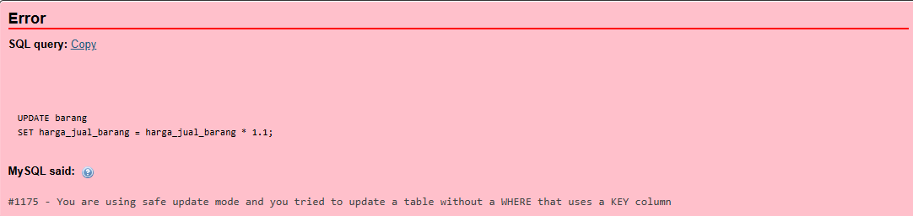

# Laporan Praktikum Basis Data - Pertemuan 06

> **Nama:** Nazia Karinnafila  
> **NIM:** 25430035  
> **Kelas:** B  
> **Tanggal:** 04 November 2026
---

## 1. Tujuan Praktikum

- Mahasiswa mampu menambahkan data dengan INSERT banyak baris dan INSERT SELECT
- Dapat mengubah atau menghapus data dengan menggunakan UPDATE dan DELETE secara aman
- Mahasiswa juga dapat menyusun skenario uji positif dan negatif lalu mencatat hasilnya
- dan memahami cara menyiapkan data sampel proyek yang dapat dijalankan ulang dengan skrip.

## 2. Ringkasan Dasar Teori

### Data Manipulation Language (DML)

DML (*Data Manipulation Language*) adalah bagian dari SQL (*Structured Query Language*) yang digunakan untuk mengelola dan memanipulasi data dalam *database*. DML memungkinkan pengguna untuk melakukan berbagai operasi pada data seperti INSERT (menambahkan data), UPDATE (memperbarui data), dan DELETE (menghapus data). Dengan menggunakan DML, kita dapat mengubah informasi yang tersimpan dalam tabel *database* sesuai dengan kebutuhan aplikasi atau sistem. 

### Penggunaan Perintah UPDATE dan DELETE

#### UPDATE

Seperti artinya, yaitu memperbarui/mengedit. perintah ini digunakan untuk memperbarui data dalam sbuah tabel. Biasanya perintah ini berpasangan dengan where untuk menentukan kondisinya. Jika kita menggunakan perintah update tanpa menggunakan where, otomatis dalam satu tabel tersebut akan berubah semua.

#### DELETE

Perintah ini digunakan untuk menghapus data dalam tabel. Biasanya juga berpasangan dengan where untuk menentukan kondisinya. kalau penggunaan perintah ini tanpa disertai kondisi, datanya akan terhapus semua.

### Uji Positif dan Negatif

Uji positif adalah metode pengujian perangkat lunak yang bertujuan memastikan suatu fitur atau sistem dapat berjalan sesuai harapan ketika menerima input yang valid. Dalam metode ini, tester menggunakan data yang benar dan mengikuti alur penggunaan yang telah ditentukan untuk memverifikasi bahwa aplikasi menghasilkan keluaran yang sesuai. 

Uji Negatif adalah metode pengujian perangkat lunak yang bertujuan memastikan aplikasi tetap dapat menangani input atau kondisi yang tidak valid dengan benar. Dalam metode ini, *tester* sengaja memasukkan data yang salah, kosong, atau tidak sesuai dengan ketentuan untuk melihat bagaimana sistem merespons. 

---

## 3. Hasil Langkah Percobaan 

### Mengisi Data Induk

```sql
INSERT INTO petugas (kode_petugas, nama_petugas, peran_petugas)
SELECT 'K06', 'Dimas Uji', 'kasir'
WHERE NOT EXISTS (SELECT 1 FROM petugas WHERE kode_petugas = 'K06');
INSERT INTO petugas (kode_petugas, nama_petugas, peran_petugas)
SELECT 'K07', 'Sari Uji', 'kasir'
WHERE NOT EXISTS (SELECT 1 FROM petugas WHERE kode_petugas = 'K07');
INSERT INTO petugas (kode_petugas, nama_petugas, peran_petugas)
SELECT 'K08', 'Rina Uji', 'kasir'
WHERE NOT EXISTS (SELECT 1 FROM petugas WHERE kode_petugas = 'K08');
INSERT INTO petugas (kode_petugas, nama_petugas, peran_petugas)
SELECT 'G06', 'Joko Uji', 'gudang'
WHERE NOT EXISTS (SELECT 1 FROM petugas WHERE kode_petugas = 'G06');
INSERT INTO petugas (kode_petugas, nama_petugas, peran_petugas)
SELECT 'P06', 'Ketua Kopma Uji', 'ketua'
WHERE NOT EXISTS (SELECT 1 FROM petugas WHERE kode_petugas = 'P06');
INSERT INTO barang
(kode_barang, nama_barang, kategori_barang, harga_jual_barang, stok_barang, stok_min_barang)
SELECT 'ATK-001', 'Pulpen Gel 0.5', 'ATK', 4000, 120, 20
WHERE NOT EXISTS (SELECT 1 FROM barang WHERE kode_barang = 'ATK-001');
INSERT INTO barang
(kode_barang, nama_barang, kategori_barang, harga_jual_barang, stok_barang, stok_min_barang)
SELECT 'ATK-002', 'Buku Tulis 58', 'ATK', 6500, 80, 20
WHERE NOT EXISTS (SELECT 1 FROM barang WHERE kode_barang = 'ATK-002');
INSERT INTO barang
(kode_barang, nama_barang, kategori_barang, harga_jual_barang, stok_barang, stok_min_barang)
SELECT 'MNM-001', 'Air Mineral 600', 'minuman', 4000, 48, 24
WHERE NOT EXISTS (SELECT 1 FROM barang WHERE kode_barang = 'MNM-001');
INSERT INTO barang
(kode_barang, nama_barang, kategori_barang, harga_jual_barang, stok_barang, stok_min_barang)
SELECT 'MKN-001', 'Roti Cokelat', 'makanan', 5000, 6, 10
WHERE NOT EXISTS (SELECT 1 FROM barang WHERE kode_barang = 'MKN-001');
-- Anggota dan pemasok:
-- Database kopma_035_uji saat ini sudah memiliki minimal 3 anggota (termasuk
-- satu nonaktif) dan 2 pemasok. Periksa sebelum menambahkan data tambahan:
SELECT no_anggota, nim_anggota, nama_anggota, status_anggota FROM anggota;
SELECT * FROM pemasok;
```

### Mencatat Nota Penjualan

```sql
INSERT INTO penjualan (no_nota_penjualan, tgl_penjualan, id_petugas, id_anggota, bayar_penjualan)
VALUES ('PJ-2609-0142', '2026-09-24 10:15:00', 3, 1, 30000);
INSERT INTO detail_penjualan (id_penjualan, id_barang, qty_detail_penjualan, harga_satuan_detail_penjualan)
SELECT 1, id_barang, 3, harga_jual_barang FROM barang WHERE kode_barang = 'ATK-001';
```

```sql
SELECT id_penjualan, no_nota_penjualan, id_petugas, id_anggota
FROM penjualan
WHERE no_nota_penjualan = 'PJ-2609-0142';
```

#### Pemeriksaan hasil data induk

```sql
SELECT kode_petugas, nama_petugas, peran_petugas FROM petugas ORDER BY kode_petugas;
SELECT kode_barang, nama_barang, kategori_barang, harga_jual_barang, stok_barang
FROM barang
ORDER BY kode_barang;
```
ERROR 1175 safe update mode



### Tabel Uji Kopma

| Kode | Masukan | Harapan | Aturan |
|---|---|---|---|
| UJ-01 | Nota baru dengan anggota aktif (UJI-AKTIF-01) | Diterima, ID penjualan 10, ID petugas 1, ID anggota 1 | AB-02 |
| UJ-02 | Nota tanpa anggota (UJI-NULL-01) | Diterima, `id_anggota` = NULL, ID penjualan 11, ID petugas 1 | AB-02 |
| UJ-03 | Stok barang diubah menjadi -5 | Ditolak, Error 4025 | AB-03 |
| UJ-04 | Nota dengan nomor duplikat PJ-2609-0142 | Ditolak, Error 1062 | AB-01 |
| UJ-05 | Detail penjualan dengan qty = 0 | Ditolak, Error 4025 | `ck_detail_qty` |
| UJ-06 | Anggota dengan NIM duplikat 2230876 | Ditolak, Error 1062 | AB-05 |
| UJ-07 | Penjualan menggunakan `id_petugas` = 999 yang tidak terdaftar | Ditolak, Error 1452 | `fk_penjualan_petugas` |
| UJ-08 | UPDATE tanpa WHERE yang menggunakan kolom kunci saat `sql_safe_updates` = 1, pada tabel sementara `uji_safe_update` | Ditolak, Error 1175 | Kebijakan lab |

---

## 4. Jawaban Titik Analisis

### Titik Analisis 1

Perintah INSERT ... SELECT lebih aman dikarenakan mengurangi Risiko kesalahan input dan menjaga konsistensi data. Jika harga pulpen naik menjadi Rp4.500 minggu depan, nota PJ-2609-0142 tidak akan ikut berubah karena harga satuan sudah tersimpan di table detail_penjualan saat transaksi dibuat.

### Titik Analisis 2

Karena menggunakan constraint ON DELETE CASCADE pada relasi antara tabel penjualan dan detail_penjualan nota mengahapus detail penjualannya. Penghapusan petugas ditolak karena tabel penjualan memiliki foreign key yang merujuk ke tabel petugas, sehingga petugas yang masih digunakan dalam transaksi tidak dapat dihapus.

Cara yang benar jika seorang kasir berhenti bekerja yaitu mengubah status petugas menjadi tidak aktif, apabila kolom status tersedia, bukan menghapus datanya.

### Titik Analisis 3

Pengujian yang diperkirakan gagal adalah AB-03: penjualan dengan kuantitas melebihi stok yang tersedia. Misalnya, stok pulpen hanya 5 buah, tetapi transaksi mencatat pembelian 9 buah.

Constraint CHECK pada tabel barang hanya memeriksa nilai yang tersimpan pada baris tabel barang. Constraint tersebut tidak otomatis membandingkan jumlah yang diminta pada detail_penjualan dengan stok yang tersedia di barang. Untuk mencegahnya, diperlukan logika tambahan, seperti trigger atau transaksi dengan pemeriksaan stok sebelum penjualan disimpan.

---

## 5. Hasil Latihan dan Modifikasi

### Pengarsipan anggota

Tabel anggota_arsip berhasil dibuat menggunakan CREATE TABLE ... LIKE. Namun, tidak ada anggota berstatus nonaktif yang mendaftar sebelum 1 Januari 2025, sehingga tidak ada data yang dipindahkan atau dihapus dari tabel anggota.

### Perubahan harga barang

```sql
SELECT id_barang, nama_barang, kategori_barang, harga_jual_barang
FROM barang
WHERE kategori_barang = 'makanan';
```

Hasil perubahan harga:

| Barang | Harga setelah naik 5% |
|---|---|
| Roti Cokelat (ID 6) | Rp4.200 |
| Roti Cokelat (ID 14) | Rp5.300 |

Perintah UPDATE berhasil menaikkan harga barang kategori makanan sebesar 5% dan membulatkannya ke ratusan terdekat. Hasilnya, harga barang ID 6 menjadi Rp4.200 dan barang ID 14 menjadi Rp5.300.

---

## 6. Tugas Mandiri: Milestone Proyek 06

### Pemeriksaan Data (Sebelum Uji)

| No. | Pemeriksaan | Perintah | Hasil yang Diharapkan |
|:---:|---|---|---|
| 1 | Tabel induk minimal 5 baris | `SELECT COUNT(*) FROM pasien;`<br>`SELECT COUNT(*) FROM obat;`<br>`SELECT COUNT(*) FROM pemasok;` | Pasien: 5, obat: 5, pemasok: 5 |
| 2 | Tabel transaksi utama minimal 10 × P = 90 baris | `SELECT COUNT(*) FROM kunjungan;` | 90 baris |
| 3 | Tabel transaksi lainnya | Periksa jumlah baris tabel `pemeriksaan`, `resep`, `detail_resep`, `pembayaran`, `penerimaan`, dan `detail_penerimaan`. | 90, 74, 113, 90, 4, dan 10 baris |
| 4 | Minimal tiga tanggal berbeda | `SELECT tanggal_kunjungan, COUNT(*) FROM kunjungan GROUP BY tanggal_kunjungan;` | 18 tanggal, masing-masing 5 baris |
| 5 | Jumlah total pembayaran | `SELECT SUM(total_bayar) FROM pembayaran;` | 5.043.000 |
| 6 | Jumlah stok akhir seluruh obat | `SELECT SUM(stok_obat) FROM obat;` | 435 |
| 7 | Tidak ada stok negatif | `SELECT MIN(stok_obat) FROM obat;` | 30 |
| 8 | Setiap resep memuat minimal 1 obat | `SELECT COUNT(*) FROM resep r WHERE NOT EXISTS (SELECT 1 FROM detail_resep d WHERE d.id_resep = r.id_resep);` | 0 resep tanpa obat |

### Hasil Pengujian Basis Data Klinik

| Kode | Masukan | Harapan | Aturan |
|---|---|---|---|
| UJ-01 | Kunjungan baru untuk pasien terdaftar | Diterima | AB-02 |
| UJ-02 | Pemeriksaan dan resep dengan 2 obat untuk kunjungan tersebut | Diterima | AB-03, AB-04, AB-05 |
| UJ-03 | Pembayaran untuk kunjungan baru | Diterima | AB-07 |
| UJ-04 | Pasien tanpa nama (NULL) | Ditolak, ERROR 1048 | `nama_pasien` NOT NULL |
| UJ-05 | Menghapus resep uji | Diterima, rincian obat ikut terhapus | `fk_detail_resep_resep` (ON DELETE CASCADE) |
| UJ-06 | Kunjungan untuk pasien yang tidak ada | Ditolak, ERROR 1452 | `fk_kunjungan_pasien` |
| UJ-07 | Pasien dengan nomor pasien yang sudah ada | Ditolak, ERROR 1062 | `uq_pasien_no` |
| UJ-08 | Pasien dengan NIK yang sudah ada | Ditolak, ERROR 1062 | `uq_pasien_nik` |
| UJ-09 | Kunjungan dengan nomor kunjungan yang sudah ada | Ditolak, ERROR 1062 | `uq_kunjungan_no` |
| UJ-10 | Stok obat diubah menjadi -1 | Ditolak, ERROR 4025 | `ck_obat_stok` |
| UJ-11 | Detail resep dengan jumlah obat 0 | Ditolak, ERROR 4025 | `ck_detail_resep_jumlah` |
| UJ-12 | Obat yang sama dua kali dalam satu resep | Ditolak, ERROR 1062 | `pk_detail_resep` |
| UJ-13 | Menghapus pasien yang sudah memiliki kunjungan | Ditolak, ERROR 1451 | `fk_kunjungan_pasien` |
| UJ-14 | Pembayaran untuk kunjungan yang tidak ada | Ditolak, ERROR 1452 | `fk_pembayaran_kunjungan` |
| UJ-15 | Pembayaran dengan `total_bayar` negatif | Ditolak, ERROR 4025 | `ck_pembayaran_total` |
| UJ-16 | Detail resep dengan jumlah obat melebihi stok | Seharusnya ditolak | AB-06 |
| UJ-17 | Satu resep dengan 12 jenis obat | Seharusnya ditolak | AB-09 (P + 2 = 11) |
| UJ-18 | Resep tanpa satu pun obat | Seharusnya ditolak | AB-05 |

#### Pengujian Negatif

1. **UJ-04 – Pasien tanpa nama (NULL)**  
   Hasil yang diharapkan: Ditolak, ERROR 1048.  
   Hasil nyata: ERROR 1048 – Column 'nama_pasien' cannot be null.  
   Status: LULUS.

2. **UJ-06 – Kunjungan untuk pasien yang tidak ada**  
   Hasil yang diharapkan: Ditolak, ERROR 1452.  
   Hasil nyata: ERROR 1452 – fk_kunjungan_pasien.  
   Status: LULUS.

3. **UJ-07 – Pasien dengan nomor pasien yang sudah ada**  
   Hasil yang diharapkan: Ditolak, ERROR 1062.  
   Hasil nyata: ERROR 1062 – for key uq_pasien_no.  
   Status: LULUS.

4. **UJ-08 – Pasien dengan NIK yang sudah ada**  
   Hasil yang diharapkan: Ditolak, ERROR 1062.  
   Hasil nyata: ERROR 1062 – for key uq_pasien_nik.  
   Status: LULUS.

5. **UJ-09 – Kunjungan dengan nomor kunjungan yang sudah ada**  
   Hasil yang diharapkan: Ditolak, ERROR 1062.  
   Hasil nyata: ERROR 1062 – for key uq_kunjungan_no.  
   Status: LULUS.

6. **UJ-10 – Stok obat diubah menjadi -1**  
   Hasil yang diharapkan: Ditolak, ERROR 4025.  
   Hasil nyata: ERROR 4025 – ck_obat_stok failed.  
   Status: LULUS.

7. **UJ-11 – Detail resep dengan jumlah obat 0**  
   Hasil yang diharapkan: Ditolak, ERROR 4025.  
   Hasil nyata: ERROR 4025 – ck_detail_resep_jumlah failed.  
   Status: LULUS.

8. **UJ-12 – Obat yang sama dua kali dalam satu resep**  
   Hasil yang diharapkan: Ditolak, ERROR 1062.  
   Hasil nyata: ERROR 1062 – for key PRIMARY.  
   Status: LULUS.

9. **UJ-13 – Menghapus pasien yang sudah memiliki kunjungan**  
   Hasil yang diharapkan: Ditolak, ERROR 1451.  
   Hasil nyata: ERROR 1451 – fk_kunjungan_pasien.  
   Status: LULUS.

10. **UJ-14 – Pembayaran untuk kunjungan yang tidak ada**  
   Hasil yang diharapkan: Ditolak, ERROR 1452.  
   Hasil nyata: ERROR 1452 – fk_pembayaran_kunjungan.  
   Status: LULUS.

11. **UJ-15 – Pembayaran dengan total_bayar negatif**  
   Hasil yang diharapkan: Ditolak, ERROR 4025.  
   Hasil nyata: ERROR 4025 – ck_pembayaran_total failed.  
   Status: LULUS.

#### Pengujian Gagal

1. **UJ-16 – Detail resep dengan jumlah obat melebihi stok**  
   Hasil yang diharapkan: Ditolak karena jumlah obat melebihi stok.  
   Hasil nyata: Data diterima (1 row inserted), dengan jumlah_obat sebanyak 500 sedangkan stok_obat hanya 115.  
   Status: GAGAL (UD-01).

2. **UJ-17 – Satu resep dengan 12 jenis obat**  
   Hasil yang diharapkan: Ditolak karena batas maksimal adalah P + 2 = 11 jenis obat.  
   Hasil nyata: Data diterima dan satu resep memuat 12 jenis obat.  
   Status: GAGAL (UD-02).

3. **UJ-18 – Resep tanpa satu pun obat**  
   Hasil yang diharapkan: Ditolak karena setiap resep seharusnya memiliki minimal satu obat.  
   Hasil nyata: Data diterima sehingga jumlah resep tanpa obat bertambah dari 0 menjadi 1.  
   Status: GAGAL (UD-03).

Skenario terdiri atas 4 uji positif, 11 uji negatif, dan 3 uji yang diperkirakan gagal.

---

## 7. Pembahasan dan Kendala

Praktikum basis data klinik_035 diisi menggunakan skrip p06_data_25430035.sql. Tabel pasien, obat, dan pemasok masing-masing berisi 5 baris, sedangkan tabel kunjungan berisi 90 baris sesuai ketentuan 10 × P dengan P = 9. Tabel pemeriksaan berisi 90 baris, resep 74 baris, detail_resep 113 baris, pembayaran 90 baris, penerimaan 4 baris, dan detail_penerimaan 10 baris. Pengujian dilakukan melalui 18 skenario, dengan 4 skenario positif berhasil diterima dan 11 skenario negatif ditolak sesuai aturan. Namun, ditemukan tiga aturan bisnis yang belum dijaga oleh struktur tabel, yaitu jumlah obat melebihi stok (AB-06), jumlah jenis obat melebihi batas (AB-09), dan resep tanpa obat (AB-05). Hal ini terjadi karena constraint CHECK tidak dapat memeriksa kondisi yang melibatkan banyak baris atau tabel, sehingga diperlukan aturan tambahan yang akan dibahas pada Modul 14.

Terdapat beberapa kendala saat memastikan setiap pengujian dilakukan pada basis data yang benar dan menghasilkan respons sesuai dengan aturan yang diuji. Beberapa perintah menghasilkan pesan kesalahan seperti error 4025 untuk pelanggaran CHECK, error 1062 untuk data duplikat, error 1452 untuk foreign key yang tidak valid, serta error 1451 ketika data induk masih digunakan oleh tabel lain. Skrip data sempat dijalankan sebelum skrip DDL sehingga urutan eksekusi diperbaiki dengan menjalankan p05_ddl_25430035.sql terlebih dahulu, kemudian p06_data_25430035.sql.

---

## 8. Kesimpulan

Dari praktikum ini mahasiswa dapat memahami bahwa perintah DML seperti INSERT, UPDATE, dan DELETE digunakan untuk menambah, mengubah, dan menghapus data dalam basis data. Pengujian menunjukkan bahwa constraint seperti CHECK, UNIQUE, dan FOREIGN KEY dapat menjaga keakuratan data dengan menolak data yang tidak sesuai aturan. Selain itu, penggunaan ON DELETE CASCADE dan SQL_SAFE_UPDATES membantu mengatur penghapusan data yang saling berhubungan serta mengurangi risiko perubahan data yang tidak disengaja.

---

## 9. Pernyataan Penggunaan AI

Membantu menjawab pertanyaan titik analisis

---

## 10. Bukti Git (tautan repositori + hash commit)

- **Repositori:** <https://github.com/naziakarinnafila-byte/basisdata_25430035.git>
- **Branch:** p05-sync
- **Hash commit:** `9fe85e6`

---

## Checklist

| | Jenis | Yang harus ada |
|:---:|---|---|
| ✔ | Berkas wajib | `p06_data_<NIM>.sql` (data sampel berbasis parameter P) dan `p06_uji_<NIM>.md` (skenario uji) |
| ✔ | Bukti tangkapan layar | Hasil skenario uji positif dan negatif; jumlah baris per tabel |
| ✔ | Analisis wajib | Tabel skenario uji: masukan, hasil yang diharapkan, hasil nyata, status |
