# Laporan Praktikum Basis Data - Pertemuan 07

> **Nama:** Nazia Karinnafila  
> **NIM:** 25430035  
> **Kelas:** B  
> **Tanggal:** 11 November 2026
---

## 1. Tujuan Praktikum

Mahasiswa mampu memahami cara menulis perintah SELECT dengan proyeksi kolom, alias, dan DISTINCT; Menyaring baris dengan berdasarkan operator pembanding, logika, BETWEEN, IN, LIKE, dan IS NULL; Mampu mengurutkan dan membatasi hasil dengan ORDER BY dan LIMIT; serta Menggunakan fungsi skalar string, tanggal, numerik, dan kondisional agar hasil lebih mudah dibaca dan sesuai dengan informasi yang dibutuhkan.

## 2. Ringkasan Dasar Teori

### SQL SELECT dan Fungsinya

Salah satu perintah atau [query](https://revou.co/kosakata/query) yang cukup umum digunakan untuk mengambil data dari database dan tabel, adalah query SELECT. 

Sebuah database umumnya memiliki struktur penyusun. Di dalam sebuah database, terdapat berbagai macam objek SQL, seperti views, dataset, tabel, procedure, dan lainnya.

Dalam SQL, data ini tersimpan dalam tabel yang terdiri dari baris dan kolom. Tampilan tabel dalam SQL ini dapat dibayangkan sama seperti tampilan Google Sheets, di mana ada kolom yang berisi komponen tiap tabel, dan juga baris yang berisikan data penyusun tabel tersebut. 

Perintah SELECT digunakan untuk mengambil data pada tabel tersebut. Query ini dapat digabungkan dengan perintah SQL lainnya seperti WHERE, JOIN, CASE-WHEN, dll., apabila kita ingin menerapkan beberapa kondisi penarikan tertentu, seperti: 

- menginginkan penarikan data hanya dari beberapa kolom saja
- filter kondisi di mana data mengandung unsur tertentu
- menampilkan sebagian data saja

### Kesalahan Semantik

Kesalahan semantik pada basis data adalah kesalahan dalam penulisan atau penggunaan perintah database yang secara aturan penulisan sudah benar, tetapi makna atau hasilnya tidak sesuai dengan tujuan yang diinginkan. Dengan kata lain, perintah SQL bisa berjalan tanpa error, tetapi hasil yang ditampilkan salah atau tidak sesuai kebutuhan. Penyebabnya karena tidak adanya aturan atau constraint di Database, menggabungkan data dari sumber yang berbeda, adanya kesalahan dalam input, dan tidak ada validasi di aplikasi.

---

## 3. Hasil Langkah Percobaan (tangkapan layar + keterangan)

### Proyeksi dan Penyaringan

**KI:** Persediaan barang  
**Pertanyaan:** Barang apa saja yang stoknya perlu ditambah?  
**Perkiraan hasil:** Menampilkan barang dengan stok di bawah stok minimum.

```sql
SELECT kode_barang, nama_barang, stok_barang, stok_min_barang,
  stok_min_barang - stok_barang AS kurang
FROM barang
WHERE stok_barang < stok_min_barang
ORDER BY kurang DESC;
```

**KI:** Persediaan barang  
**Pertanyaan:** Barang apa saja yang termasuk kategori ATK atau Minuman?  
**Perkiraan hasil:** Menampilkan barang dari kedua kategori tersebut.

```sql
SELECT *
FROM barang
WHERE kategori_barang IN ('ATK', 'Minuman');
```

**KI:** Data penjualan  
**Pertanyaan:** Transaksi apa saja yang terjadi selama September 2026?  
**Perkiraan hasil:** Menampilkan nota penjualan pada bulan September 2026.

```sql
SELECT no_nota_penjualan, tgl_penjualan
FROM penjualan
WHERE tgl_penjualan BETWEEN '2026-09-01 00:00:00'
  AND '2026-09-30 23:59:59'
ORDER BY tgl_penjualan;
```

**KI:** Data anggota  
**Pertanyaan:** Anggota mana yang belum memiliki nomor HP?  
**Perkiraan hasil:** Menampilkan anggota dengan nomor HP bernilai NULL.

```sql
SELECT no_anggota, nama_anggota, no_hp_anggota
FROM anggota
WHERE no_hp_anggota IS NULL;
```

### Pola Teks dan Nilai Kosong

Mencari anggota yang namanya mengandung huruf tertentu dan menampilkan di label yang mudah dibaca.

```sql
SELECT CONCAT(nama_anggota, ' (', no_anggota, ')') AS anggota,
  DATE_FORMAT(tgl_daftar_anggota, '%d-%m-%Y') AS tgl_daftar_anggota,
  IFNULL(no_hp_anggota, '-') AS hp,
  CASE status_anggota
  WHEN 'aktif' THEN 'Diskon 5%'
  ELSE 'Tanpa diskon'
  END AS keterangan
FROM anggota
WHERE nama_anggota LIKE '%a%'
ORDER BY tgl_daftar_anggota DESC
LIMIT 5;
```

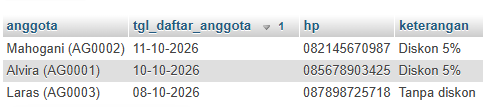

### Tanggal dan Perhitungan per Baris

Menghitung lama keanggotaan setiap anggota dalam hari dan tampilkan kategori “baru” (kurang dari 180 hari) atau “lama”.

**KI:** Data anggota  
**Pertanyaan:** Berapa lama setiap anggota telah terdaftar?

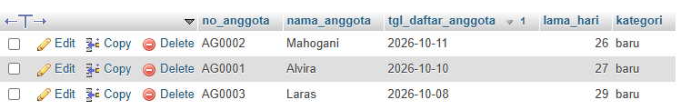

**Perkiraan hasil:** Menampilkan lama keanggotaan dalam hari dan kategori baru atau lama.

```sql
SELECT no_anggota, nama_anggota, tgl_daftar_anggota,
  DATEDIFF(CURDATE(), tgl_daftar_anggota) AS lama_hari,
  CASE
  WHEN DATEDIFF(CURDATE(), tgl_daftar_anggota) < 180
  THEN 'baru'
  ELSE 'lama'
  END AS kategori
FROM anggota
ORDER BY tgl_daftar_anggota DESC;
```

**KI:** Detail transaksi penjualan  
**Pertanyaan:** Berapa subtotal setiap barang pada nota PJ-2609-0142?  
**Perkiraan hasil:** Menampilkan jumlah barang, harga satuan, dan subtotal setiap baris transaksi.

```sql
SELECT id_penjualan, id_barang, qty_detail_penjualan,
  harga_satuan_detail_penjualan,
  qty_detail_penjualan * harga_satuan_detail_penjualan AS subtotal
FROM detail_penjualan
WHERE id_penjualan = 2;
```

---

## 4. Jawaban Titik Analisis

### Titik Analisis 1

Ketika alias kurang digunakan pada WHERE, muncul galat #1054 - Unknown column 'kurang' in 'where clause'. Hal ini terjadi karena WHERE dievaluasi sebelum SELECT. Alias kurang baru dibentuk pada tahap SELECT, sehingga belum dapat dikenali ketika WHERE dijalankan. Namun, alias tersebut dapat digunakan pada ORDER BY karena dievaluasi setelah SELECT.

### Titik Analisis 2

Kondisi WHERE no_hp_anggota = NULL tidak pernah mengembalikan baris karena NULL menunjukkan nilai yang tidak diketahui atau tidak tersedia.

Kueri yang benar:

```sql
SELECT no_anggota, nama_anggota, no_hp_anggota
FROM anggota
WHERE no_hp_anggota IS NULL;
```

Perbedaan NULL dengan string kosong (''):

1. NULL menunjukkan bahwa suatu kolom tidak memiliki nilai atau nilainya tidak diketahui.
2. String kosong ('') menunjukkan bahwa kolom berisi nilai teks kosong dengan panjang nol. Artinya, nilainya ada, tetapi tidak berisi karakter.

### Titik Analisis 3

Subtotal per baris dapat dihitung menggunakan operasi perkalian antara jumlah barang (qty_detail_penjualan) dan harga satuan (harga_satuan_detail_penjualan). Perhitungan tersebut dilakukan secara terpisah pada setiap baris transaksi, sehingga menghasilkan subtotal untuk masing-masing barang. Sebaliknya, total nota belum dapat diperoleh hanya dengan operasi tersebut karena total nota merupakan hasil penjumlahan seluruh subtotal dari beberapa baris transaksi.

Fitur SQL yang dibutuhkan untuk menjumlahkan banyak baris menjadi satu nilai adalah fungsi agregat SUM(). Fungsi ini digunakan untuk menjumlahkan nilai dari beberapa baris sehingga menghasilkan satu nilai total.

---

## 5. Hasil Latihan dan Modifikasi

Menampilkan nama barang dalam huruf kapital dan harga dalam format “Rp4.000”. Petunjuk: `FORMAT(harga_jual_barang, 0, 'id_ID')`.

**Perkiraan hasil:** Nama barang uppercase dan harga dengan awalan Rp serta pemisah ribuan.

```sql
SELECT
  UPPER(nama_barang) AS nama_barang,
  CONCAT('Rp', FORMAT(harga_jual_barang, 0, 'id_ID')) AS harga
FROM barang;
```

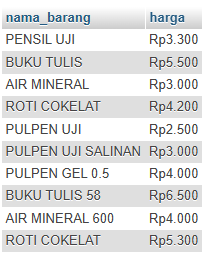

Kueri yang salah secara semantik tetapi tetap berjalan, misalnya syarat OR tanpa tanda kurung. Tunjukkan hasil salahnya

#### Kueri salah secara semantik

```sql
SELECT no_anggota, nama_anggota, status_anggota
FROM anggota
WHERE status_anggota = 'aktif'
  OR status_anggota = 'nonaktif'
  AND nama_anggota LIKE '%a%';
```

#### Kueri yang sudah diperbaiki

**Perkiraan hasil:** Hanya anggota dengan status aktif atau nonaktif dan nama mengandung huruf a.

```sql
SELECT no_anggota, nama_anggota, status_anggota
FROM anggota
WHERE (status_anggota = 'aktif'
  OR status_anggota = 'nonaktif')
  AND nama_anggota LIKE '%a%';
```

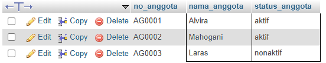

Kedua kueri sama-sama menghasilkan 3 baris karena seluruh nama anggota mengandung huruf 'a'. Namun, logikanya berbeda. Kueri pertama salah karena AND diprioritaskan daripada OR, sehingga anggota aktif tetap ditampilkan tanpa memperhatikan kondisi nama. Kueri perbaikan menggunakan tanda kurung agar kondisi nama berlaku untuk kedua status anggota.

---

## 6. Tugas Mandiri: Milestone Proyek 07

```sql
USE klinik_035;
```

### Q01

**KI-04**

**Pertanyaan:** Obat apa saja yang stoknya di bawah 100, dan berapa kurangnya dari batas itu? Urutkan dari yang paling kurang.

**Hasil yang diharapkan:** 2 baris.

1. Amoxicillin 500 mg (kapsul), stok 30, kurang 70
2. Paracetamol 500 mg (tablet), stok 40, kurang 60

```sql
SELECT nama_obat, satuan, stok_obat, 100 - stok_obat AS kurang
FROM obat
WHERE stok_obat < 100
ORDER BY kurang DESC;
```

### Q02

**KI-01**

**Pertanyaan:** Lima kunjungan terbaru yang jenisnya Rawat Jalan atau Kontrol ulang itu yang mana saja?

**Hasil yang diharapkan:** 5 baris, diurutkan dari tanggal terbaru lalu nomor kunjungan terbesar (tiga baris tanggal 2025-05-02, dua baris tanggal 2025-04-30):

1. KJ-0090-2025, Rawat Jalan, 2025-05-02
2. KJ-0089-2025, Rawat Jalan, 2025-05-02
3. KJ-0088-2025, Rawat Jalan, 2025-05-02
4. KJ-0085-2025, Rawat Jalan, 2025-04-30
5. KJ-0084-2025, Rawat Jalan, 2025-04-30

```sql
SELECT no_kunjungan, jenis_kunjungan, tanggal_kunjungan
FROM kunjungan
WHERE jenis_kunjungan IN ('Rawat Jalan', 'Kontrol ulang')
ORDER BY tanggal_kunjungan DESC, no_kunjungan DESC
LIMIT 5;
```

### Q03

**KI-06** (bagian satu tabel; nama pasien perlu JOIN, lihat akhir berkas)

**Pertanyaan:** Kunjungan apa saja yang terjadi dari 10 sampai 12 April 2025?

**Hasil yang diharapkan:** 15 baris, KJ-0001-2025 sampai KJ-0015-2025, tanggal 2025-04-10, 2025-04-11, dan 2025-04-12 masing-masing 5 baris.

```sql
SELECT no_kunjungan, id_pasien, tanggal_kunjungan, jenis_kunjungan
FROM kunjungan
WHERE tanggal_kunjungan BETWEEN '2025-04-10' AND '2025-04-12'
ORDER BY tanggal_kunjungan, no_kunjungan;
```

### Q04

**KI-01** (kualitas data pasien, p02 bagian 10)

**Pertanyaan:** Adakah pasien yang belum punya alamat atau nomor HP?

**Hasil yang diharapkan:** 0 baris, karena kelima pasien pada data Pertemuan 6 memiliki alamat dan nomor HP. Hasil kosong di sini benar, bukan galat.

```sql
SELECT no_pasien, nama_pasien, alamat, no_HP
FROM pasien
WHERE alamat IS NULL OR no_HP IS NULL;
```

### Q05

**KI-01**

**Pertanyaan:** Jenis kunjungan apa saja yang ada di klinik?

**Hasil yang diharapkan:** 3 baris, urut abjad: Kontrol ulang, Pemeriksaan umum, Rawat Jalan.

```sql
SELECT DISTINCT jenis_kunjungan
FROM kunjungan
ORDER BY jenis_kunjungan;
```

### Q06

**KI-01**

**Pertanyaan:** Tampilkan pasien yang namanya mengandung huruf "a" dengan label "nama (nomor pasien)", tanggal lahir format hari-bulan-tahun, nomor HP (diganti "-" bila kosong), dan keterangan jenis kelamin. Urutkan dari yang paling muda, ambil 5.

**Hasil yang diharapkan:** 5 baris (kelima pasien bernama mengandung "a"):

1. Rizky Ramadhan (P-0005-2025), 27-05-2001, 085277712345, Laki-laki
2. Dewi Lestari (P-0004-2025), 03-11-1992, 082144403311, Perempuan
3. Siti Rahma (P-0002-2025), 22-03-1988, 081298765432, Perempuan
4. Andi Pratama (P-0001-2025), 10-01-1985, 081234567890, Laki-laki
5. Budi Hartono (P-0003-2025), 15-07-1979, 081355501122, Laki-laki

```sql
SELECT CONCAT(nama_pasien, ' (', no_pasien, ')') AS pasien,
  DATE_FORMAT(tanggal_lahir, '%d-%m-%Y') AS tgl_lahir,
  IFNULL(no_HP, '-') AS hp,
  CASE jenis_kelamin WHEN 'L' THEN 'Laki-laki'
  ELSE 'Perempuan' END AS keterangan
FROM pasien
WHERE nama_pasien LIKE '%a%'
ORDER BY tanggal_lahir DESC
LIMIT 5;
```

### Q07

**KI-02** (bagian satu tabel; nama pasien perlu JOIN, lihat akhir berkas)

**Pertanyaan:** Pemeriksaan mana saja yang diagnosisnya berkaitan dengan alergi? Tampilkan diagnosis dalam huruf kapital, ambil 10 pertama.

**Hasil yang diharapkan:** 10 baris (dari total 16 pemeriksaan bertema alergi), berupa RINITIS ALERGI atau DERMATITIS ALERGI. Baris pertama: pemeriksaan 4, kunjungan 4, RINITIS ALERGI. Baris keenam: pemeriksaan 27, DERMATITIS ALERGI.

```sql
SELECT id_pemeriksaan, id_kunjungan, UPPER(diagnosis) AS diagnosis
FROM pemeriksaan
WHERE diagnosis LIKE '%alergi%'
ORDER BY id_pemeriksaan
LIMIT 10;
```

### Q08

**KI-03** (bagian satu tabel; nama pasien dan obatnya perlu JOIN)

**Pertanyaan:** Resep apa saja yang ditulis dokter yang namanya diawali "dr. Budi" pada 10 sampai 16 April 2025? Tampilkan lima nomor resep pertama.

**Hasil yang diharapkan:** 5 baris (dari total 12 resep dr. Budi pada rentang itu):

1. R-0001-2025, 2025-04-10
2. R-0002-2025, 2025-04-10
3. R-0005-2025, 2025-04-10
4. R-0006-2025, 2025-04-11
5. R-0009-2025, 2025-04-11

```sql
SELECT no_resep, tanggal_resep, dokter
FROM resep
WHERE dokter LIKE 'dr. Budi%'
  AND tanggal_resep BETWEEN '2025-04-10' AND '2025-04-16'
ORDER BY no_resep
LIMIT 5;
```

### Q09

**KI-05** (bagian satu tabel; jumlah dan total per hari perlu fungsi agregat)

**Pertanyaan:** Lima pembayaran pertama yang memakai QRIS atau transfer itu termasuk kategori besar, sedang, atau kecil? Besar: 70000 ke atas; sedang: 55000 sampai 69999; kecil: di bawah 55000.

**Hasil yang diharapkan:** 5 baris, diurutkan dari id pembayaran terkecil:

1. id 1, 2025-04-10, 70000, transfer, Besar
2. id 3, 2025-04-10, 54000, transfer, Kecil
3. id 4, 2025-04-10, 54000, QRIS, Kecil
4. id 6, 2025-04-11, 65000, QRIS, Sedang
5. id 8, 2025-04-11, 30000, QRIS, Kecil

```sql
SELECT id_pembayaran, tanggal_pembayaran, total_bayar, metode_pembayaran,
  CASE WHEN total_bayar >= 70000 THEN 'Besar'
  WHEN total_bayar >= 55000 THEN 'Sedang'
  ELSE 'Kecil' END AS kategori
FROM pembayaran
WHERE metode_pembayaran IN ('QRIS', 'transfer')
ORDER BY id_pembayaran
LIMIT 5;
```

### Q10

**KI-01**

**Pertanyaan:** Untuk tiga kunjungan (KJ-0001, KJ-0046, KJ-0090), sudah berapa hari sejak kunjungan itu sampai 2 Mei 2025, dan termasuk "baru" (kurang dari 14 hari) atau "lama"?

**Hasil yang diharapkan:** 3 baris, urut tanggal:

1. KJ-0001-2025, 2025-04-10, 22 hari, lama
2. KJ-0046-2025, 2025-04-22, 10 hari, baru
3. KJ-0090-2025, 2025-05-02, 0 hari, baru

```sql
SELECT no_kunjungan, tanggal_kunjungan,
  DATEDIFF('2025-05-02', tanggal_kunjungan) AS hari_lalu,
  CASE WHEN DATEDIFF('2025-05-02', tanggal_kunjungan) < 14
  THEN 'baru' ELSE 'lama' END AS kategori
FROM kunjungan
WHERE no_kunjungan IN ('KJ-0001-2025', 'KJ-0046-2025', 'KJ-0090-2025')
ORDER BY tanggal_kunjungan;
```

### Q11

**KI-05** (bagian satu tabel; jumlah dan total per bulan perlu fungsi agregat)

**Pertanyaan:** Pembayaran apa saja yang terjadi pada bulan Mei 2025?

**Hasil yang diharapkan:** 5 baris (semua tanggal 02-05-2025), id pembayaran 86 sampai 90: 86 = 52000, 87 = 56000, 88 = 51600, 89 = 72500, 90 = 72500

```sql
SELECT id_pembayaran,
  DATE_FORMAT(tanggal_pembayaran, '%d-%m-%Y') AS tanggal,
  total_bayar
FROM pembayaran
WHERE MONTH(tanggal_pembayaran) = 5 AND YEAR(tanggal_pembayaran) = 2025
ORDER BY id_pembayaran;
```

### Q12

**KI-03** (bagian satu tabel; nama obat dan subtotal)

**Pertanyaan:** Obat apa saja (menurut nomor obat) pada resep R-0001-2025 beserta jumlah dan aturan pakainya? Setelah data dimuat, resep ini punya id 1.

**Hasil yang diharapkan:** 2 baris:

1. id_obat 1, jumlah 10, "3 x 1 tablet, diminum setelah makan"
2. id_obat 2, jumlah 10, "3 x 1 kapsul, diminum 3 kali sehari setelah makan"

```sql
SELECT id_resep, id_obat, jumlah_obat, aturan_pemakaian
FROM detail_resep
WHERE id_resep = 1
ORDER BY id_obat;
```

### Q13

**KI-04**

**Pertanyaan:** Tampilkan nama obat dalam huruf kapital dan harga dalam format"Rp1.500", dari yang termahal.

**Hasil yang diharapkan:** 5 baris:

1. AMOXICILLIN 500 MG, Rp1.500
2. IBUPROFEN 400 MG, Rp1.000
3. CETIRIZINE 10 MG, Rp800
4. PARACETAMOL 500 MG,mRp500
5. ANTASIDA DOEN, Rp400

### Hasil Kueri

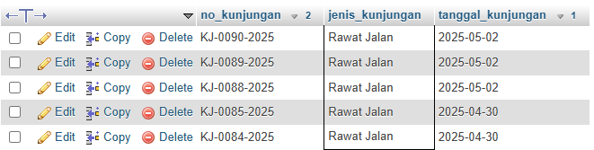
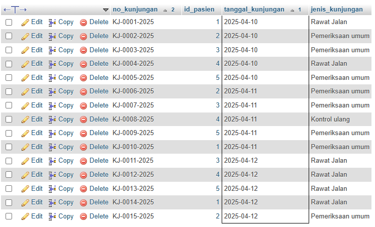
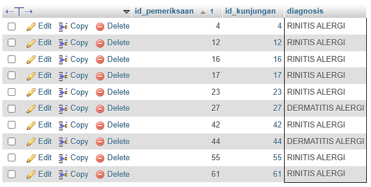
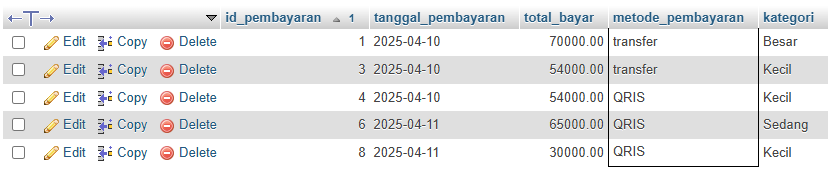
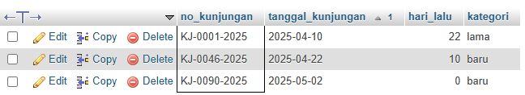
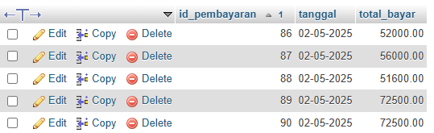
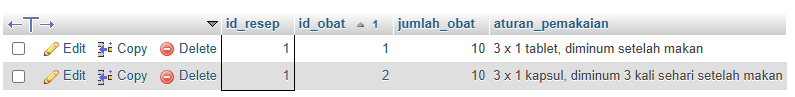

---

## 7. Pembahasan dan Kendala

Pada praktikum ini dilakukan pengolahan data menggunakan perintah SELECT dan berbagai fungsi skalar pada MySQL, serta memahami cara menampilkan kolom tertentu, memberikan alias, menyaring data menggunakan WHERE, serta mengurutkan hasil menggunakan ORDER BY dan membatasi jumlah data dengan LIMIT. Selain itu, digunakan beberapa operator penyaringan seperti IN, BETWEEN, dan IS NULL. Praktikum juga menerapkan fungsi skalar, antara lain CONCAT() untuk menggabungkan teks, DATE_FORMAT() untuk mengatur format tanggal, IFNULL() untuk menangani nilai NULL, UPPER() untuk mengubah huruf menjadi kapital, DATEDIFF() untuk menghitung selisih hari, serta CASE untuk membuat kondisi.

Selama praktikum, ditemukan beberapa kendala, yaitu penggunaan alias pada WHERE yang menyebabkan error, tidak adanya data bernilai NULL pada nomor HP anggota, serta hasil kueri AND dan OR yang sama meskipun logikanya berbeda. Selain itu, nama kolom perlu disesuaikan dengan struktur tabel agar kueri dapat dijalankan dengan benar.

---

## 8. Kesimpulan

Dari praktikum ini mahasiswa diharapkan mampu mempelajari penggunaan proyeksi kolom, alias, penyaringan data menggunakan WHERE, operator perbandingan dan logika, IN, BETWEEN, LIKE, serta IS NULL. Selain itu, memahami penggunaan fungsi skalar seperti UPPER(), CONCAT(), FORMAT(), DATE_FORMAT(), DATEDIFF(), IFNULL(), dan CASE untuk mengolah serta menampilkan data dalam format yang lebih informatif. Penggunaan ORDER BY dan LIMIT juga membantu mengurutkan serta membatasi jumlah data yang ditampilkan.

---

## 9. Pernyataan Penggunaan AI

Membantu menjawab pertanyaan titik analisis

---

## 10. Bukti Git (tautan repositori + hash commit)

<https://github.com/naziakarinnafila-byte/basisdata_25430035.git>

```text
e26cd94..8165151 p05-sync -> p05-sync
```

---

## Checklist

| | Jenis | Yang harus ada |
|:---:|---|---|
| ✔ | Berkas wajib | `p07_kueri_<NIM>.sql` berisi minimal 10 kueri satu tabel, masing-masing diberi komentar KI dan hasil yang diharapkan |
| ✔ | Bukti tangkapan layar | Hasil setiap kueri |
| ✔ | Analisis wajib | Pemetaan kueri → KI; alasan pemilihan fungsi skalar yang dipakai |
