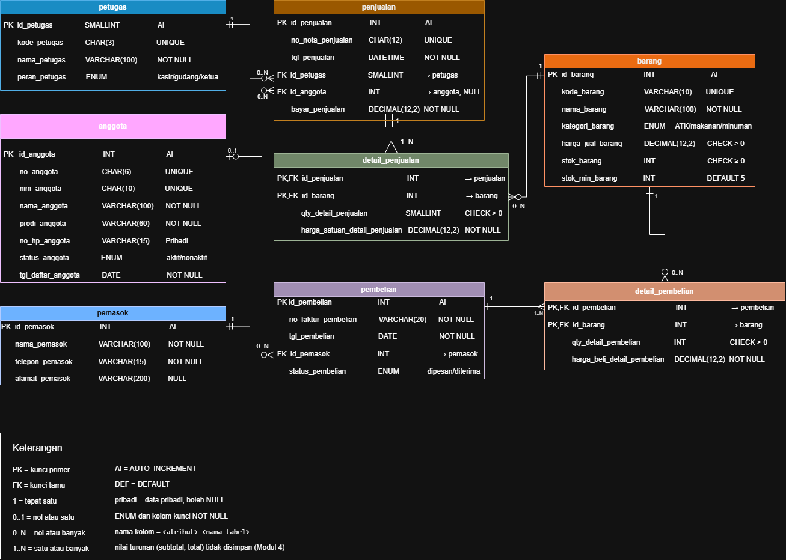
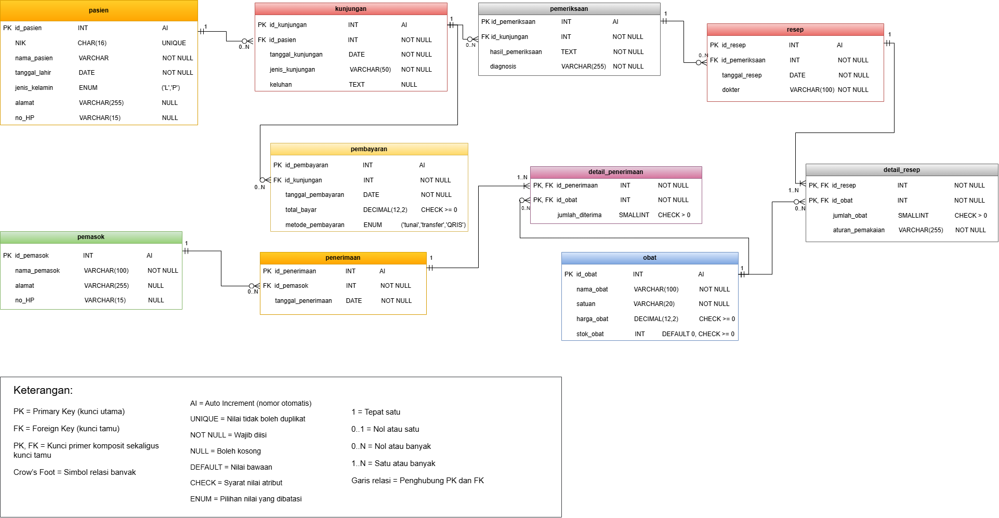

# Laporan Praktikum Basis Data — Pertemuan 3

> **Topik:** Perancangan Entity-Relationship Diagram (ERD) dengan notasi Crow’s Foot  
> **Nama:** Nazia Karinnafila  
> **NIM:** 25430035  
> **Kelas:** B  
> **Tanggal:** 14 Oktober 2026

## 1. Tujuan Praktikum

Praktikum ini bertujuan agar mahasiswa mampu:

- Mengidentifikasi entitas, atribut, dan kunci berdasarkan dokumen kebutuhan data.
- Menentukan relasi, kardinalitas, dan partisipasi berdasarkan aturan bisnis.
- Memecah relasi banyak-ke-banyak (*many-to-many*) menjadi entitas asosiatif.
- Menggambar ERD menggunakan notasi Crow’s Foot dan memvalidasinya terhadap kebutuhan informasi.

## 2. Dasar Teori

### 2.1 Entity-Relationship Diagram (ERD)

ERD adalah model konseptual untuk menggambarkan struktur data dalam basis data. Komponen utamanya meliputi:

- **Entitas:** objek nyata atau abstrak yang dapat diidentifikasi secara unik.
- **Atribut:** karakteristik atau informasi yang disimpan untuk suatu entitas.
- **Relasi:** hubungan ant entitas yang menunjukkan keterkaitan data.

### 2.2 Kardinalitas

Kardinalitas menunjukkan jumlah keterhubungan antarentitas. Bentuk yang umum digunakan:

- **One-to-one (1:1):** satu entitas berhubungan dengan paling banyak satu entitas lain, dan sebaliknya.
- **One-to-many (1:N):** satu entitas dapat berhubungan dengan banyak entitas lain, sedangkan setiap entitas di sisi sebaliknya terhubung ke satu entitas.
- **Many-to-many (N:M):** banyak entitas pada satu sisi dapat berhubungan dengan banyak entitas pada sisi lainnya. Dalam rancangan relasional, relasi ini umumnya dipecah melalui entitas asosiatif.

## 3. Hasil Langkah Percobaan

### 3.1 Identifikasi atribut kunci pada entitas Kopma

| Entitas | Atribut | Penanda |
|---|---|---|
| Anggota | `no_anggota` | PK |
| Anggota | `nim_anggota` | AK |
| Penjualan | `no_nota_penjualan` | Kunci unik |
| Detail_Penjualan | `no_nota_penjualan` | FK |
| Detail_Penjualan | `kode_barang` | FK |
| Detail_Penjualan | `subtotal_detail_penjualan` | Atribut turunan |

Keterangan: **PK** = *Primary Key*, **FK** = *Foreign Key*, **AK** = kunci alternatif.

### 3.2 Pemecahan entitas pembelian

Entitas kandidat **Pembelian dan detailnya** dipecah menjadi `pembelian` dan `detail_pembelian`, mengikuti pola pemisahan transaksi penjualan dan detail penjualan.

| `pembelian` | `detail_pembelian` |
|---|---|
| PK `no_nota_pembelian` | PK, FK `no_nota_pembelian` |
| `tanggal_pembelian` | PK, FK `kode_barang` |
| FK `kode_pemasok` | `qty_detail_pembelian` |
| — | `harga_satuan_detail_pembelian` |

### 3.3 Relasi dan kardinalitas pada sistem Kopma

| Relasi | Sisi kiri | Sisi kanan | Dasar aturan |
|---|---|---|---|
| Petugas melayani penjualan | Tepat satu petugas | Nol atau banyak penjualan | Wawancara kasir |
| Anggota melakukan penjualan | Nol atau satu anggota | Nol atau banyak penjualan | AB-02 |
| Penjualan berisi detail penjualan | Tepat satu penjualan | Satu atau banyak detail | AB-01 |
| Barang tercantum di detail penjualan | Tepat satu barang | Nol atau banyak detail | AB-04 |
| Pemasok terkait pembelian | Tepat satu pemasok | Nol atau banyak pembelian | AB-06 |
| Pembelian berisi detail pembelian | Tepat satu pembelian | Satu atau banyak detail | Faktur pemasok |

## 4. Jawaban Titik Analisis

### 4.1 Pemilihan kunci primer anggota

`id_anggota` dipilih sebagai kunci primer karena menjadi identitas khusus setiap anggota. `no_anggota` dan `nim_anggota` dapat menjadi identitas tambahan selama nilainya unik. Jika NIM dijadikan kunci primer, perubahan NIM berpotensi mengharuskan penyesuaian pada tabel lain yang menggunakannya sebagai referensi.

### 4.2 Minimal satu detail pada penjualan

Aturan bisnis **AB-01** menyatakan bahwa setiap penjualan harus memiliki minimal satu detail barang. Karena itu, kardinalitas dari `penjualan` ke `detail_penjualan` adalah **satu atau banyak (1..N)**, bukan nol atau banyak (0..N). Batas minimal ini memerlukan validasi tambahan pada sistem basis data atau alur transaksi, karena struktur tabel saja belum tentu menjamin setiap transaksi memiliki detail.

### 4.3 Informasi petugas pada pembelian/penerimaan

ERD yang ada belum dapat menjawab kebutuhan untuk mengetahui petugas yang menangani pembelian atau penerimaan. Jika informasi tersebut memang dibutuhkan Kopma, entitas `petugas` perlu dihubungkan ke entitas pembelian atau penerimaan melalui atribut yang sesuai. Perubahan ini perlu ditetapkan sebagai aturan bisnis baru.

## 5. Hasil Latihan dan Modifikasi

Riwayat poin sebaiknya disimpan dalam entitas `riwayat_poin`, bukan hanya sebagai atribut jumlah poin pada entitas anggota. Dengan demikian, sistem dapat menelusuri waktu perubahan poin, jumlah perubahan, serta penyebab penambahan atau pengurangannya.

> **Catatan:** Dokumen praktikum juga mencantumkan latihan menggambar ulang relasi penjualan–barang sebagai relasi banyak-ke-banyak langsung tanpa entitas asosiatif.

## 6. Tugas Mandiri — Milestone Proyek 03

### 6.1 Tabel relasi dan kardinalitas

| Relasi | Sisi kiri | Sisi kanan | Dasar |
|---|---|---|---|
| Pasien memiliki kunjungan | Tepat satu pasien | Nol atau banyak kunjungan | AB-02 |
| Kunjungan terkait pemeriksaan | Tepat satu kunjungan | Nol atau banyak pemeriksaan | AB-03 |
| Pemeriksaan menjadi dasar resep | Tepat satu pemeriksaan | Nol atau banyak resep | AB-04 |
| Resep berisi detail resep | Tepat satu resep | Satu atau banyak detail resep | AB-05 |
| Obat tercantum dalam detail resep | Tepat satu obat | Nol atau banyak detail resep | AB-05 |
| Kunjungan memiliki pembayaran | Tepat satu kunjungan | Nol atau banyak pembayaran | AB-07 |
| Pemasok terkait penerimaan | Tepat satu pemasok | Nol atau banyak penerimaan | Aktivitas pengadaan obat |
| Penerimaan berisi detail penerimaan | Tepat satu penerimaan | Satu atau banyak detail penerimaan | Aktivitas pengadaan obat |
| Obat tercantum dalam detail penerimaan | Tepat satu obat | Nol atau banyak detail penerimaan | Aktivitas pengadaan obat |

### 6.2 Penelusuran kebutuhan informasi ke jalur ERD

| Kode | Kebutuhan informasi | Jalur ERD |
|---|---|---|
| KI-01 | Jumlah pasien terdaftar dan jumlah kunjungan per hari/bulan | `pasien → kunjungan` |
| KI-02 | Riwayat pemeriksaan pasien berdasarkan catatan kunjungan | `pasien → kunjungan → pemeriksaan` |
| KI-03 | Daftar resep dan obat yang diberikan kepada pasien | `pasien → kunjungan → pemeriksaan → resep → detail_resep → obat` |
| KI-04 | Daftar obat dengan stok di bawah batas minimum | `obat` |
| KI-05 | Jumlah dan total pembayaran pasien per hari/bulan | `pasien → kunjungan → pembayaran` |
| KI-06 | Daftar pasien yang melakukan kunjungan dalam rentang waktu tertentu | `pasien ← kunjungan` |

### 6.3 Standar kelengkapan ERD konseptual

| Unsur | Ketentuan | Penerapan |
|---|---|---|
| Entitas | Nama tabel huruf kecil di kepala kotak dan satu warna per entitas | Gunakan nama seperti `pasien`, `kunjungan`, dan `pemeriksaan`; konsistenkan warna. |
| Atribut | Seluruh atribut dari kamus data dicantumkan | Periksa dokumen kebutuhan data dan hasil Pertemuan 2. |
| Kunci | PK, FK, dan kunci primer komposit diberi label | Tandai PK/FK dengan jelas; gunakan PK komposit pada tabel asosiatif sesuai rancangan. |
| Kardinalitas | Kedua ujung relasi menggunakan simbol Crow’s Foot dan label angka | Cantumkan nilai seperti `1`, `0..1`, `0..N`, atau `1..N`. |
| Garis relasi | Garis menghubungkan PK dengan FK yang dirujuk dan tidak bertumpuk | Rapikan jalur relasi agar mudah dibaca. |
| Keterangan | Legenda simbol tersedia di bagian bawah diagram | Jelaskan PK, FK, Crow’s Foot, dan label kardinalitas. |

## 7. Catatan Tinjauan Klien dan Keputusan

### Catatan tinjauan klien

1. Data pasien sudah lengkap, tetapi atribut NIK perlu dipastikan tidak boleh memiliki nilai yang sama.
2. Data penerimaan obat perlu mencatat jumlah obat yang diterima dari pemasok.

### Keputusan

1. Atribut NIK pada entitas `pasien` diberi constraint `UNIQUE` agar setiap pasien memiliki NIK berbeda.
2. Entitas asosiatif `detail_penerimaan` digunakan untuk menghubungkan penerimaan obat dan menyimpan atribut `jumlah_diterima`.

## 8. Pembahasan dan Kendala

Praktikum berfokus pada pengubahan dokumen kebutuhan data dari Pertemuan 2 menjadi ERD agar struktur data lebih mudah dipahami. Tahapan pengerjaan mencakup identifikasi entitas dan atribut, penentuan primary key dan foreign key, serta penetapan relasi dan kardinalitas menggunakan notasi Crow’s Foot. ERD kemudian ditinjau berdasarkan kebutuhan informasi untuk memastikan informasi yang diperlukan dapat diperoleh melalui jalur relasi yang sesuai.

Kendala utama adalah menentukan primary key dan foreign key secara tepat, memecah relasi banyak-ke-banyak menjadi entitas asosiatif, serta memastikan seluruh kebutuhan informasi terwakili dalam ERD.

## 9. Kesimpulan

Praktikum ini membahas penyusunan ERD menggunakan notasi Crow’s Foot, identifikasi entitas, atribut, dan kunci berdasarkan kebutuhan data, serta pemecahan relasi banyak-ke-banyak melalui entitas asosiatif. Validasi relasi dan kardinalitas terhadap aturan bisnis dan kebutuhan informasi menjadi bagian penting agar rancangan ERD dapat mendukung kebutuhan sistem.

## 10. Pernyataan Penggunaan AI

AI digunakan untuk membantu menjawab pertanyaan pada bagian titik analisis.

## 11. Bukti dan Repositori GitHub

- **Repositori:** [basisdata_25430035](https://github.com/naziakarinnafila-byte/basisdata_25430035.git)
- **Bukti commit yang tercantum pada dokumen sumber:** `2398819..725af1767d7798`

### Checklist berkas dan analisis

- [x] Berkas ERD Kopma dan ERD proyek (`p03_erd_kopma_<NIM>` dan `p03_erd_<NIM>`) dalam bentuk gambar dan sumber diagram.
- [x] Tangkapan layar ERD di draw.io dengan kardinalitas yang terbaca serta catatan tinjauan klien.
- [x] Pemetaan setiap entitas ke PB/KI dari Pertemuan 2 dan alasan kardinalitas relasi utama.

---

*Dokumen ini disusun ulang dari laporan praktikum sumber untuk format Markdown yang lebih mudah dibaca di GitHub. Isi teknis dipertahankan berdasarkan dokumen sumber.*
